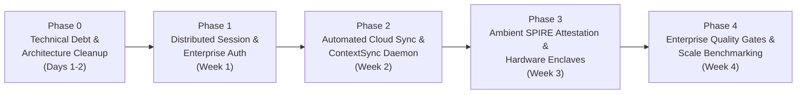
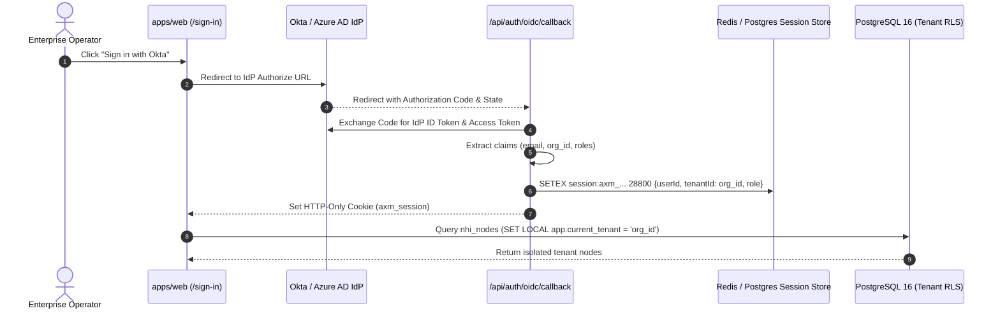
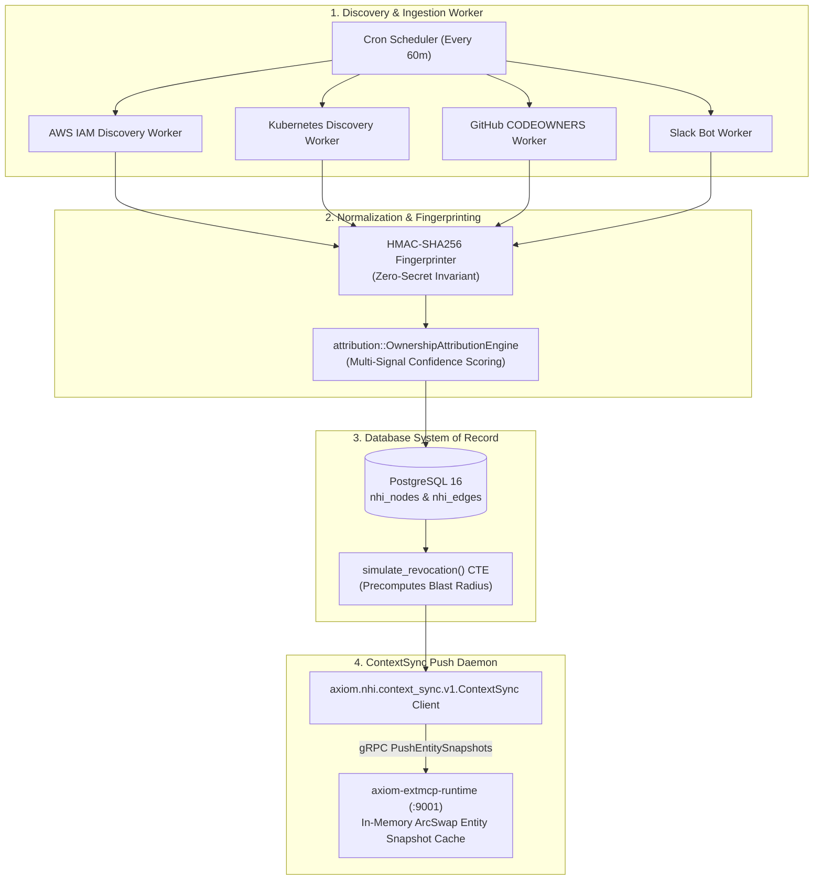
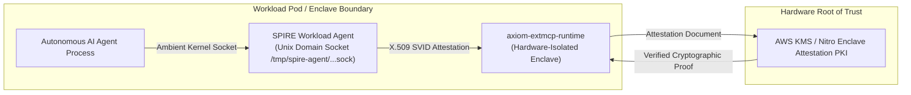

# Axiom NHI — Master Production Implementation Plan

**Plan Title:** Axiom NHI Production Engineering & Architecture Remediation Roadmap  
**Document Classification:** Authoritative Phased Implementation Blueprint  
**Monorepo:** `c:\Users\Lenovo\Desktop\Axiom`  
**License:** Apache-2.0  
**Target Architecture:** Rust ExtMCP Runtime + Next.js 15 Cloud Control Plane + PostgreSQL 16 + OpenBao  

---

## Executive Roadmap Overview

This implementation plan bridges the gap between Axiom NHI's current verified capabilities (18 compiling Rust crates, 0.31ms inline policy evaluation, 31 Next.js routes) and an **enterprise-ready, multi-tenant, horizontally scalable production platform**.



---

## Phase 0: Technical Debt & Architectural Cleanup (Immediate Pre-requisites)

### 0.1 Objectives & Deliverables
1. **Eliminate Dual-Control-Plane Confusion:** Formally retire and archive `gateway/local-admin-api/server.cjs`. Ensure all frontend tools, scripts, and documentation point exclusively to the Rust Axum admin surface (`services/extmcp/runtime/src/admin.rs` on port `8787`).
2. **Embed Database Migrations on Runtime Boot:** Wire `lineage_graph::PostgresLineageGraph::run_migrations(&self)` directly into `services/extmcp/runtime/src/main.rs`. When `DATABASE_URL` is configured, migrations execute automatically before accepting traffic.
3. **Clarify Frontend Console Boundaries:** Formally designate `apps/web/app/console` as the primary multi-tenant Cloud Control Plane and `apps/gateway-ui` as the lightweight air-gapped on-premises operator UI.

### 0.2 Implementation Tasks & Code Changes

```
┌─────────────────────────────────────────────────────────────────────────────────────────┐
│ Task 0.1: Retire Legacy Node.js Admin Script                                            │
│ Target: gateway/local-admin-api/server.cjs -> gateway/local-admin-api/README.md          │
│ Action: Replace mock script with deprecation notice pointing to Rust admin.rs           │
├─────────────────────────────────────────────────────────────────────────────────────────┤
│ Task 0.2: Automatic Embedded Database Migration on Service Boot                         │
│ Target: services/extmcp/runtime/src/main.rs                                             │
│ Action: Add conditional PostgreSQL connection & migration run:                          │
│         if let Ok(db_url) = std::env::var("DATABASE_URL") {                             │
│             let graph = PostgresLineageGraph::connect(&db_url).await?;                  │
│             graph.run_migrations().await?;                                              │
│         }                                                                               │
├─────────────────────────────────────────────────────────────────────────────────────────┤
│ Task 0.3: Align Gateway-UI Local Admin Ports                                            │
│ Target: apps/gateway-ui/vite.config.ts                                                  │
│ Action: Proxy /v1/* requests directly to http://127.0.0.1:8787 (Rust Engine)            │
└─────────────────────────────────────────────────────────────────────────────────────────┘
```

### 0.3 Verification Criteria
- `gateway/local-admin-api/server.cjs` is archived without breaking any test suite.
- Starting `cargo run -p extmcp-runtime` against an empty PostgreSQL database initializes `nhi_nodes`, `nhi_edges`, and `simulate_revocation()` automatically.
- `cargo check --workspace` passes with 0 errors.

---

## Phase 1: Distributed Session Architecture & Enterprise Authentication

### 1.1 Objectives & Deliverables
1. **Replace In-Memory Session Store:** Refactor `apps/web/app/api/auth/store.ts` to support distributed session persistence (Redis or PostgreSQL session store) while retaining local disk-backed fallback for offline single-node development.
2. **Multi-Tenant Row-Level Security (RLS):** Apply PostgreSQL 16 RLS policies on `nhi_nodes` and `nhi_edges` ensuring absolute data isolation across tenant workspaces (`tenant_id = current_setting('app.current_tenant')`).
3. **Enterprise SSO & OIDC Provider Wiring:** Complete `apps/web/app/api/auth/oidc/callback/route.ts` to exchange authorization codes with enterprise identity providers (Okta, Azure AD, Google Workspace) and establish tenant context.

### 1.2 Architecture & Flow



### 1.3 Implementation Tasks
- **Task 1.1:** Add `@upstash/redis` or `ioredis` dependency to `apps/web/package.json`.
- **Task 1.2:** Update `apps/web/app/api/auth/store.ts` with a pluggable adapter interface:
  `export interface SessionAdapter { getSession(id): Promise<SessionRecord | null>; saveSession(s): Promise<void>; }`
- **Task 1.3:** Create migration `lineage-graph/migrations/0002_tenant_rls.sql` enabling RLS:
  `ALTER TABLE nhi_nodes ENABLE ROW LEVEL SECURITY;`
  `CREATE POLICY tenant_isolation_policy ON nhi_nodes USING (tenant_id = current_setting('app.current_tenant', true));`

### 1.4 Verification Criteria
- Logging in on Pod A and refreshing on Pod B preserves session state via Redis.
- A query executing as Tenant A cannot read or write records belonging to Tenant B.
- `pnpm --filter @axiom/web typecheck` and `pnpm --filter @axiom/web build` pass with 0 errors.

---

## Phase 2: Automated Multi-Cloud Discovery & ContextSync Daemon

### 2.1 Objectives & Deliverables
1. **Background Discovery Cron Worker:** Operationalize `connectors/src/discovery.rs` as a resilient background service scheduled via `tokio::time` or `cron` (e.g. every 60 minutes).
2. **Cloud Credential Provider Configuration:** Provide declarative credential bindings for AWS STS AssumeRole, Kubernetes in-cluster service account tokens, GitHub App private keys, and Slack bot tokens.
3. **Live ContextSync Daemon (`proto/context_sync.proto`):** Push precomputed PostgreSQL risk scores (`blast_radius_score`, `exposure_score`, `is_shadow_nhi`) into ExtMCP's in-memory `ArcSwap` cache so inline evaluation on port `9001` has real-time risk intelligence without hitting the database.

### 2.2 Architecture & Flow



### 2.3 Implementation Tasks
- **Task 2.1:** Implement `DiscoveryDaemon` in `connectors/src/daemon.rs` with configurable intervals and exponential backoff retry.
- **Task 2.2:** Add offline synthetic fixtures in `connectors/src/fixtures.rs` so tests and zero-cloud local development run reliably without active cloud credentials.
- **Task 2.3:** Implement `ContextSyncService` in `services/extmcp/runtime` consuming `PushEntitySnapshotsRequest` and atomically updating an in-memory `ArcSwap<HashMap<String, EntityContextSnapshot>>`.

### 2.4 Verification Criteria
- Scheduled discovery runs passively without exceeding AWS/GitHub rate limits (verified via `TokenBucketLimiter`).
- Discovery populates `nhi_nodes` in PostgreSQL with correct CODEOWNERS attribution.
- ExtMCP inline evaluation (`CheckRequest`) inspects `context.is_shadow_nhi` and blocks unowned agents attempting high-risk tools.

---

## Phase 3: Ambient SPIRE Attestation & Hardware Enclaves

### 3.1 Objectives & Deliverables
1. **Ambient SPIFFE Workload API Client:** Implement a native Unix domain socket client in `identity/src/spiffe.rs` connecting to `/tmp/spire-agent/public/api.sock`. Containers and local agents automatically fetch their SPIFFE SVID without requiring manual static token configuration.
2. **Confidential Computing & Enclave Manifests:** Author deployment manifests and documentation for running `axiom-extmcp-runtime` inside **AWS Nitro Enclaves** or GCP Confidential VMs.
3. **KMS Cryptographic Key Attestation:** Integrate AWS KMS / GCP Cloud KMS for signing audit ledger Merkle roots.

### 3.2 Architecture & Flow



### 3.3 Implementation Tasks
- **Task 3.1:** Add `spiffe = "0.2"` crate dependency or implement custom Tokio Unix domain socket gRPC client for the SPIFFE Workload API.
- **Task 3.2:** Wire automatic SVID rotation in `identity/src/verifier.rs`.
- **Task 3.3:** Create `deployments/enclaves/aws-nitro/enclave-manifest.json` and Dockerfile for building confidential EIF images.

### 3.4 Verification Criteria
- Workload running alongside SPIRE agent authenticates via ambient Unix socket in <1ms without any static `Authorization: Bearer` secret.
- Enclave attestation document passes verification against AWS KMS root of trust.

---

## Phase 4: Enterprise Quality Gates, High-Throughput Benchmarks & Security Hardening

### 4.1 Objectives & Deliverables
1. **Gate G1 Performance Benchmark Harness:** Run k6 and Python benchmark suites under 10,000 requests/second load to empirically verify:
   - $p_{50}$ latency $< 0.8\text{ ms}$
   - $p_{95}$ latency $< 1.5\text{ ms}$
   - $p_{99}$ latency $< 2.0\text{ ms}$
2. **Automated Red-Team CI Regression Gate:** Wire `mcp-red-team-fuzzer` into GitHub Actions CI to execute 200+ adversarial mutations (destructive SQL, path traversal, private IP SSRF, schema tampering) on every PR.
3. **End-to-End Multi-Service Integration Test:** Automated test verifying:
   `Agent` &rarr; `Envoy` &rarr; `ExtMCP (:9001)` &rarr; `Cedar v4` &rarr; `OpenBao JIT Lease (:8200)` &rarr; `PostgreSQL 16` &rarr; `SSE (:8787)` &rarr; `Browser UI`.

### 4.2 Benchmark Test Plan (Gate G1)

```
Test Scenario: High-Volume Concurrent MCP Tool Invocations
Load: 10,000 req/s across 50 concurrent virtual agents
Payload Mix:
  - 85% Permitted Read-Only SQL (SELECT id FROM customer_db)
  - 10% Destructive SQL Injections (DROP TABLE, TRUNCATE, stacked queries)
  - 3% Path Traversal Attempts (../../etc/passwd)
  - 2% SSRF Cloud Metadata Attacks (http://169.254.169.254)

Pass Criteria:
  [x] Zero false permits on destructive or attack payloads (Fail-Closed = 100%)
  [x] p50 inline latency <= 0.8ms
  [x] p99 inline latency <= 2.0ms
  [x] Zero memory leaks over 24-hour soak run (Tokio / Rust heap verification)
```

---

## Phase Execution Timeline & Milestones

| Milestone | Target Horizon | Primary Crates & Files | Key Deliverable |
|---|---|---|---|
| **Phase 0: Technical Debt** | **Days 1–2** | `gateway/local-admin-api/server.cjs`, `services/extmcp/runtime/src/main.rs` | Retire legacy Node script, embed SQL migrations on boot |
| **Phase 1: Distributed Auth** | **Week 1** | `apps/web/app/api/auth/*`, `lineage-graph/migrations/0002_tenant_rls.sql` | Multi-node Redis/Postgres session store + PostgreSQL RLS |
| **Phase 2: Discovery Daemon** | **Week 2** | `connectors/src/discovery.rs`, `proto/context_sync.proto` | Scheduled discovery worker + real-time risk context sync |
| **Phase 3: Ambient SPIRE** | **Week 3** | `identity/src/spiffe.rs`, `deployments/enclaves/` | Ambient Unix socket SVID attestation + Nitro Enclaves |
| **Phase 4: Quality & Scale** | **Week 4** | `tests/performance/`, `.agents/skills/mcp-red-team-fuzzer` | Gate G1 10k req/s benchmark verification & CI security gate |
