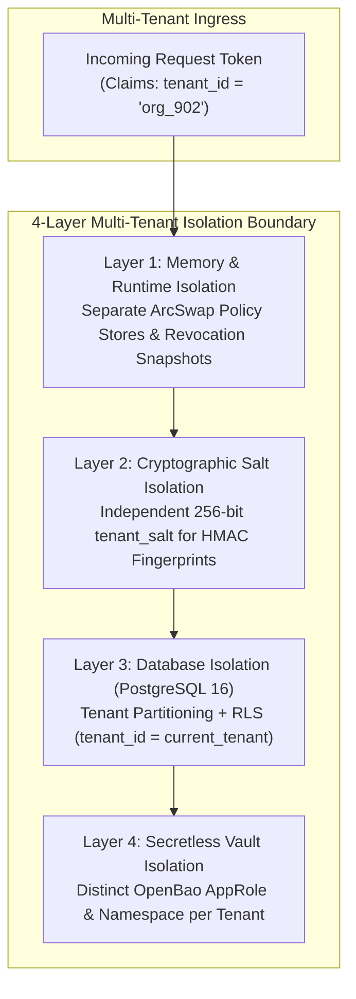

# Axiom NHI — Authentication, Authorization & Multi-Tenancy Specification

**Document:** `docs/architecture/complete-audit/AUTH_AND_TENANCY.md`  
**Classification:** Identity, Session Governance & Multi-Tenant Isolation  
**Primary Modules:** `apps/web/app/api/auth/*`, `apps/web/middleware.ts`, `identity`, `services/extmcp/runtime/src/admin.rs`  

---

## 1. Authentication Architecture

Axiom NHI supports two distinct authentication realms:
1. **Human Operator Authentication (Cloud Control Plane):** Manages security administrators, platform engineers, and SOC analysts logging into the web dashboard (`/console`).
2. **Machine & Agent Workload Authentication (Inline Data Plane):** Manages autonomous AI agents and MCP tool servers communicating over HTTP and gRPC.

### 1.1 Human Session Management (`apps/web/app/api/auth`)
- **Session Mechanism:** Uses an encrypted, HTTP-only session cookie named `axm_session`.
- **Session Attributes:**
  - `userId`: Canonical user identifier (`usr_...`).
  - `tenantId`: Organization tenant identifier (`org_...`).
  - `email`: Operator email address.
  - `name`: Display name.
  - `role`: Role assignment (`security-admin`, `soc-operator`, `platform-engineer`, `auditor`).
  - `csrfToken`: Anti-CSRF token validated on state-changing requests.
- **Production PostgreSQL Pooling & Schema (`lineage-graph/migrations/0003_operator_auth_and_scim.sql`):**
  - `apps/web/app/api/auth/store.ts` implements connection pooling via `pg.Pool` backed by PostgreSQL tables: `tenants`, `operators`, and `operator_sessions`.
  - Seamless offline fallback is maintained for local tests when `DATABASE_URL` is unconfigured.
  - Includes WebAuthn step-up signature verification (`verifyStepUpSignature`) to authenticate high-risk operations.
- **OIDC & SCIM Integration:**
  - `apps/web/app/api/auth/oidc/callback/route.ts` provides enterprise Single Sign-On (SSO) integration with Okta, Azure AD, and Google Workspace.
  - Compatible with SCIM 2.0 provisioning schemas for automated enterprise user and group synchronization.

### 1.2 Machine & Service Authentication (`identity`)
- **OAuth 2.1 Compliance:** Workload tokens are strictly accepted via the standard `Authorization: Bearer <token>` header. Token transmission in query parameters or URL paths is explicitly rejected (`MCP01:2025`).
- **Cryptographic Verification:** Signatures are validated against cached JSON Web Key Sets (JWKS) using RS256 or ES256 algorithms.
- **Clock Skew Bounds:** Tokens are accepted only if within $\le 30$ seconds of clock skew, minimizing replay attack windows.
- **RFC 8707 Audience Validation:** Tokens must contain an `aud` (audience) claim matching the canonical resource URI being called (e.g. `mcp://postgres-prod.internal`). Cross-resource token replays are trapped and blocked immediately.

---

## 2. Administrative Control Plane Access (`admin.rs`)

The loopback administrative surface of the Rust ExtMCP engine (:8787) is protected by a Zero-Trust multi-layered authorization model:

### 2.1 Operator Identity & Scoped Claims
Requests to `:8787` authenticate using either an `AXIOM_ADMIN_TOKEN` or a cryptographically signed Operator JWT:
```rust
pub struct OperatorClaims {
    pub tenant_id: String,
    pub sub: String,
    pub email: String,
    pub role: String, // "security-admin" | "soc-operator" | "auditor"
    pub exp: usize,
}
```

### 2.2 Role-Based Access Control (RBAC) Matrix
- **`security-admin`**: Full administrative access, including Cedar policy bundle updates (`PUT /v1/local/policies/bundle`), key rotation (`POST /v1/secretless/rotate`), and emergency kill switch revocations.
- **`soc-operator`**: Incident response capabilities, including emergency revocations (`POST /v1/local/revocations`), blast radius simulations, and read-only policy inspection.
- **`auditor`**: Read-only access to audit logs, OWASP scorecards, and live SSE event streams.

### 2.3 Single-Use 30-Second Ticket Nonce for SSE Streaming
To prevent browser URL token exposure and browser credential leaks:
1. The frontend control plane calls `POST /v1/local/events/ticket` with its Bearer session token.
2. The runtime generates a cryptographically random, single-use ticket nonce with a 30-second TTL stored in `SseTicketStore`.
3. The browser opens the SSE connection via `GET /v1/local/events/stream?ticket=<ticket_id>`.
4. The runtime atomically consumes and deletes the ticket from memory, preventing any replay.
5. Telemetry frames emitted over the SSE channel are strictly filtered to the operator's `tenant_id`.

### 2.4 WebAuthn Step-Up Signature Enforcement
In production environments (`AXIOM_ENV=production`), destructive operations (`PUT /v1/local/policies/bundle`, `POST /v1/secretless/rotate`, `POST /v1/local/revocations`) enforce the presence of an `X-Axiom-StepUp-Signature` header, verifying cryptographic proof of real-time human authorization.

### 2.5 Fail-Closed Startup Validation
To eliminate insecure configurations in production, `services/extmcp/runtime/src/main.rs` validates environment flags at boot. If `AXIOM_ENV=production` is detected alongside `AXIOM_ALLOW_ANONYMOUS_LOCAL=1` or `AXIOM_DEV_MODE=1`, the runtime terminates immediately with a fatal security error (`std::process::exit(1)`).

### 2.6 Constant-Time Token Comparison
To prevent timing side-channel attacks during static token comparison:
```rust
// services/extmcp/runtime/src/admin.rs
fn constant_time_eq(left: &[u8], right: &[u8]) -> bool {
    let mut diff = left.len() ^ right.len();
    for index in 0..left.len().max(right.len()) {
        diff |= usize::from(
            left.get(index).copied().unwrap_or(0) ^ right.get(index).copied().unwrap_or(0),
        );
    }
    diff == 0
}
```

---

## 3. Multi-Tenancy & Data Isolation



1. **Runtime Isolation:** Active policies, revocation maps, and cached entities are namespaced. An agent belonging to Tenant A cannot trigger actions or query tool schemas belonging to Tenant B (`MCP10:2025`).
2. **Cryptographic Salt Separation:** Credential fingerprints are computed using `HMAC-SHA256(tenant_salt, credential_id)`. Two identical credentials owned by different tenants produce completely distinct hashes, preventing cross-tenant correlation.
3. **Database Row-Level Security (RLS):** In shared PostgreSQL clusters, every table (`nhi_nodes`, `nhi_edges`) includes a `tenant_id` column protected by strict RLS policies.
4. **Vault Namespacing:** OpenBao dynamic credential leases are isolated to tenant-specific paths (`vault://openbao/v1/tenant-org_902/...`).
