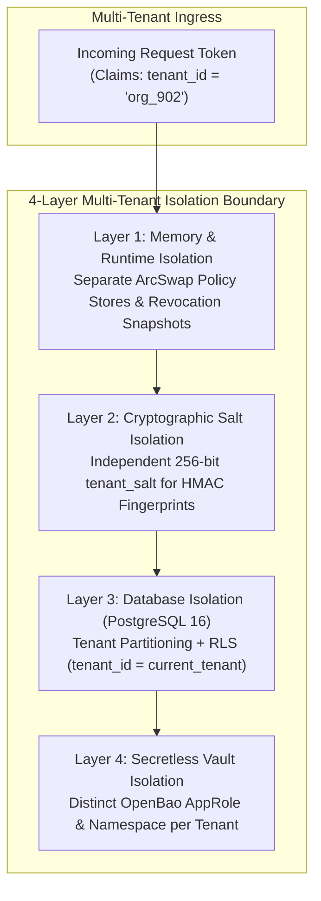

# Axiom NHI — Authentication, Authorization & Multi-Tenancy Specification

**Document:** `docs/architecture/complete-audit/AUTH_AND_TENANCY.md`  
**Classification:** Identity, Session Governance & Multi-Tenant Isolation  
**Primary Modules:** `apps/web/app/api/auth/*`, `apps/web/middleware.ts`, `identity`, `services/extmcp/runtime/src/admin.rs`  

---

## 1. Authentication Architecture

Axiom NHI supports two distinct authentication realms:
1. **Human Operator Authentication (Cloud Control Plane):** Manages security administrators, platform engineers, and SOC analysts logging into the web dashboard (`/console`).
2. **Machine & Agent Workload Authentication (Inline Data Plane):** Manages autonomous AI agents and MCP tool servers communicating over HTTP and gRPC.

### 1.1 Human Session Management (`apps/web/app/api/auth`)
- **Session Mechanism:** Uses an encrypted, HTTP-only session cookie named `axm_session`.
- **Session Attributes:**
  - `userId`: Canonical user identifier (`usr_...`).
  - `tenantId`: Organization tenant identifier (`org_...`).
  - `email`: Operator email address.
  - `name`: Display name.
  - `role`: Role assignment (`security-admin`, `soc-operator`, `platform-engineer`, `auditor`).
  - `csrfToken`: Anti-CSRF token validated on state-changing requests.
- **In-Memory & OIDC Integration:**
  - `apps/web/app/api/auth/store.ts` provides a high-speed in-memory store for evaluation and local deployments.
  - `apps/web/app/api/auth/oidc/callback/route.ts` provides enterprise Single Sign-On (SSO) integration with Okta, Azure AD, and Google Workspace.

### 1.2 Machine & Service Authentication (`identity`)
- **OAuth 2.1 Compliance:** Workload tokens are strictly accepted via the standard `Authorization: Bearer <token>` header. Token transmission in query parameters or URL paths is explicitly rejected (`MCP01:2025`).
- **Cryptographic Verification:** Signatures are validated against cached JSON Web Key Sets (JWKS) using RS256 or ES256 algorithms.
- **Clock Skew Bounds:** Tokens are accepted only if within $\le 30$ seconds of clock skew, minimizing replay attack windows.
- **RFC 8707 Audience Validation:** Tokens must contain an `aud` (audience) claim matching the canonical resource URI being called (e.g. `mcp://postgres-prod.internal`). Cross-resource token replays are trapped and blocked immediately.

---

## 2. Administrative Control Plane Access (`admin.rs`)

The loopback administrative surface of the Rust ExtMCP engine (:8787) is protected by a high-entropy secret token:
- **Environment Variable:** `AXIOM_ADMIN_TOKEN` (requires minimum 32 bytes of entropy).
- **Constant-Time Verification:** To prevent timing side-channel attacks during token validation, `admin.rs` implements constant-time byte array comparison:
  ```rust
  // services/extmcp/runtime/src/admin.rs:209-217
  fn constant_time_eq(left: &[u8], right: &[u8]) -> bool {
      let mut diff = left.len() ^ right.len();
      for index in 0..left.len().max(right.len()) {
          diff |= usize::from(
              left.get(index).copied().unwrap_or(0) ^ right.get(index).copied().unwrap_or(0),
          );
      }
      diff == 0
  }
  ```
- **Local Dev Bypass:** In local developer mode, setting `AXIOM_ALLOW_ANONYMOUS_LOCAL=1` or `AXIOM_DEV_MODE=1` permits loopback browser requests from `localhost:3000` without requiring an admin token header.

---

## 3. Multi-Tenancy & Data Isolation



1. **Runtime Isolation:** Active policies, revocation maps, and cached entities are namespaced. An agent belonging to Tenant A cannot trigger actions or query tool schemas belonging to Tenant B (`MCP10:2025`).
2. **Cryptographic Salt Separation:** Credential fingerprints are computed using `HMAC-SHA256(tenant_salt, credential_id)`. Two identical credentials owned by different tenants produce completely distinct hashes, preventing cross-tenant correlation.
3. **Database Row-Level Security (RLS):** In shared PostgreSQL clusters, every table (`nhi_nodes`, `nhi_edges`) includes a `tenant_id` column protected by strict RLS policies.
4. **Vault Namespacing:** OpenBao dynamic credential leases are isolated to tenant-specific paths (`vault://openbao/v1/tenant-org_902/...`).
