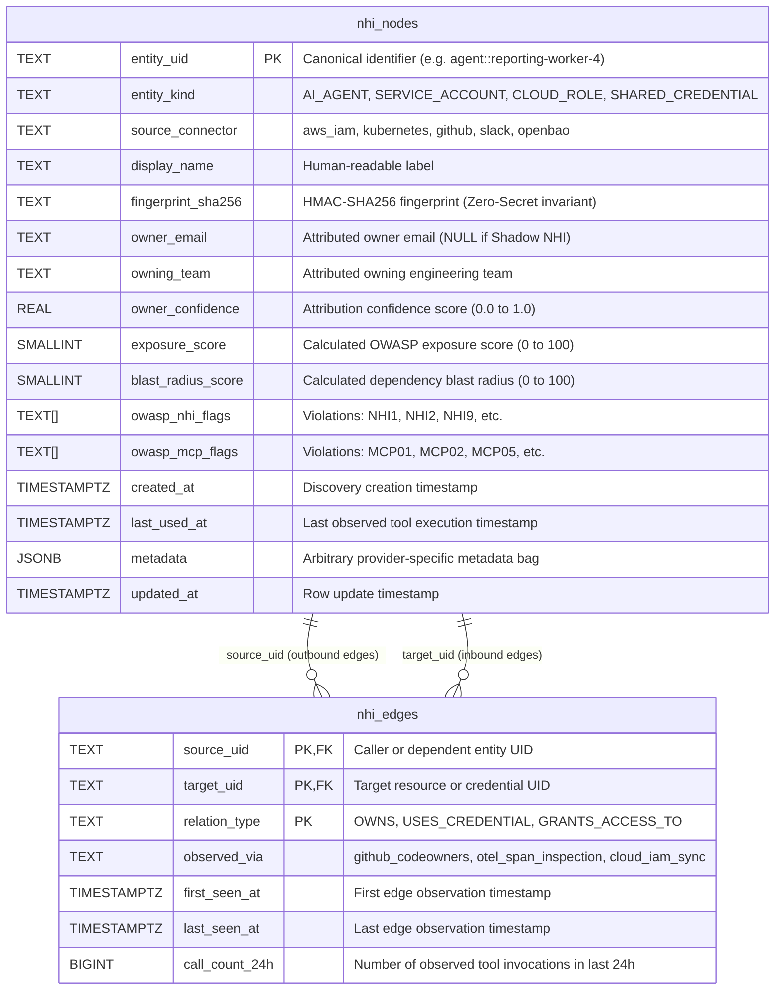

# Axiom NHI — Database & Data Architecture Specification

**Document:** `docs/architecture/complete-audit/DATABASE_ARCHITECTURE.md`  
**Classification:** Database Schema, Data Models, Migrations & Recursive Graph Storage  
**Primary Database:** PostgreSQL 16 (with SQLx async migrations and JSONB support)  
**Access Layer:** `lineage-graph/src/postgres.rs`, SQLx 0.8  

---

## 1. Database Architectural Overview

The Axiom NHI data plane uses **PostgreSQL 16** as the authoritative persistent system of record for:
1. **Identity Inventory (`nhi_nodes`):** Every discovered human, machine, workload, AI agent, shared secret, and cloud resource.
2. **Dependency & Communication Topology (`nhi_edges`):** Graph edges representing ownership (`OWNS`), usage (`USES_CREDENTIAL`), authorization (`GRANTS_ACCESS_TO`), and active runtime communication.
3. **Recursive Dependency Analysis:** Stored SQL recursive Common Table Expressions (CTEs) that calculate multi-hop blast radiuses and detect credential reuse across sibling workloads (`NHI9:2025`).

### 1.1 Zero-Secret Storage Invariant
In accordance with non-negotiable security rules, **no plaintext secrets, API keys, private keys, or passwords ever enter the database.**
All credential references in `nhi_nodes` store an **HMAC-SHA256 fingerprint** (`hmac-sha256:...`) keyed to the customer's isolated tenant salt.

### 1.2 Embedded In-Process Migration Engine
PostgreSQL schema migrations are embedded directly into the Rust `extmcp-runtime` binary via `include_str!` in `lineage-graph/src/postgres.rs`. When `services/extmcp/runtime/src/main.rs` starts, it automatically inspects `DATABASE_URL`, connects to the database pool, and executes `graph.run_migrations().await` prior to binding network listeners. This eliminates external CLI dependencies (`sqlx-cli`) for local and containerized deployments.

---

## 2. Entity-Relationship (ER) Diagram



---

## 3. Database Schema & Migration Specification

### 3.1 Migration File: `0001_phase2_graph.sql`
- **Location:** `lineage-graph/migrations/0001_phase2_graph.sql`
- **Owner:** Team 4 (Lineage Graph & Database Engineering)

#### Table: `nhi_nodes`
```sql
CREATE TABLE IF NOT EXISTS nhi_nodes (
    entity_uid TEXT PRIMARY KEY,
    entity_kind TEXT NOT NULL,
    source_connector TEXT NOT NULL,
    display_name TEXT NOT NULL,
    fingerprint_sha256 TEXT NOT NULL,
    owner_email TEXT,
    owning_team TEXT,
    owner_confidence REAL DEFAULT 0.0,
    exposure_score SMALLINT DEFAULT 0,
    blast_radius_score SMALLINT DEFAULT 0,
    owasp_nhi_flags TEXT[] DEFAULT '{}',
    owasp_mcp_flags TEXT[] DEFAULT '{}',
    created_at TIMESTAMPTZ,
    last_used_at TIMESTAMPTZ,
    metadata JSONB NOT NULL DEFAULT '{}'::jsonb,
    updated_at TIMESTAMPTZ NOT NULL DEFAULT NOW()
);
```

#### Table: `nhi_edges`
```sql
CREATE TABLE IF NOT EXISTS nhi_edges (
    source_uid TEXT NOT NULL REFERENCES nhi_nodes(entity_uid) ON DELETE CASCADE,
    target_uid TEXT NOT NULL REFERENCES nhi_nodes(entity_uid) ON DELETE CASCADE,
    relation_type TEXT NOT NULL,
    observed_via TEXT NOT NULL,
    first_seen_at TIMESTAMPTZ NOT NULL DEFAULT NOW(),
    last_seen_at TIMESTAMPTZ NOT NULL DEFAULT NOW(),
    call_count_24h BIGINT NOT NULL DEFAULT 0,
    PRIMARY KEY (source_uid, target_uid, relation_type)
);
```

#### Performance Indexes:
```sql
CREATE INDEX IF NOT EXISTS idx_nhi_edges_target ON nhi_edges(target_uid);
CREATE INDEX IF NOT EXISTS idx_nhi_nodes_unowned ON nhi_nodes(owner_email) WHERE owner_email IS NULL;
```
- `idx_nhi_edges_target`: Enables ultra-fast reverse dependency lookups (finding all callers of a secret or database in <1ms).
- `idx_nhi_nodes_unowned`: Partial index accelerating SOC discovery queries for unmanaged "Shadow NHIs".

---

### 3.2 Migration File: `0002_tenant_rls.sql`
- **Location:** `lineage-graph/migrations/0002_tenant_rls.sql`
- **Owner:** Team 4 (Database & Multi-Tenancy Architecture)
- **Purpose:** Enforces strict Row-Level Security (RLS) and multi-tenant data isolation across shared PostgreSQL infrastructure.

#### Tenant Column Alterations:
```sql
ALTER TABLE nhi_nodes ADD COLUMN IF NOT EXISTS tenant_id VARCHAR(64) NOT NULL DEFAULT 'default';
ALTER TABLE nhi_edges ADD COLUMN IF NOT EXISTS tenant_id VARCHAR(64) NOT NULL DEFAULT 'default';
```

#### Compound Tenant Indexes:
```sql
CREATE INDEX IF NOT EXISTS idx_nhi_nodes_tenant ON nhi_nodes(tenant_id, entity_uid);
CREATE INDEX IF NOT EXISTS idx_nhi_edges_tenant ON nhi_edges(tenant_id, source_uid, target_uid);
```

#### Row-Level Security Policies:
```sql
ALTER TABLE nhi_nodes ENABLE ROW LEVEL SECURITY;
ALTER TABLE nhi_edges ENABLE ROW LEVEL SECURITY;

CREATE POLICY tenant_isolation_nodes ON nhi_nodes
    FOR ALL
    USING (tenant_id = current_setting('app.current_tenant', true))
    WITH CHECK (tenant_id = current_setting('app.current_tenant', true));

CREATE POLICY tenant_isolation_edges ON nhi_edges
    FOR ALL
    USING (tenant_id = current_setting('app.current_tenant', true))
    WITH CHECK (tenant_id = current_setting('app.current_tenant', true));
```
- **Fail-Closed Tenancy:** If `app.current_tenant` is unset or mismatched, PostgreSQL returns 0 rows, guaranteeing zero cross-tenant data leakage.

---

### 3.3 Migration File: `0003_operator_auth_and_scim.sql`
- **Location:** `lineage-graph/migrations/0003_operator_auth_and_scim.sql`
- **Owner:** Core Security & Auth Architecture
- **Purpose:** Provides enterprise-grade persistent human operator authentication, tenant administration, SCIM 2.0 provisioning compatibility, and strict session governance.

#### Table: `tenants`
```sql
CREATE TABLE IF NOT EXISTS tenants (
    id VARCHAR(64) PRIMARY KEY,
    name VARCHAR(255) NOT NULL,
    slug VARCHAR(64) NOT NULL UNIQUE,
    scim_external_id VARCHAR(255),
    status VARCHAR(32) NOT NULL DEFAULT 'active',
    created_at TIMESTAMPTZ NOT NULL DEFAULT NOW(),
    updated_at TIMESTAMPTZ NOT NULL DEFAULT NOW()
);
```

#### Table: `operators`
```sql
CREATE TABLE IF NOT EXISTS operators (
    id VARCHAR(64) PRIMARY KEY,
    tenant_id VARCHAR(64) NOT NULL REFERENCES tenants(id) ON DELETE CASCADE,
    email VARCHAR(255) NOT NULL,
    name VARCHAR(255) NOT NULL,
    role VARCHAR(32) NOT NULL DEFAULT 'auditor',
    password_hash VARCHAR(255),
    scim_external_id VARCHAR(255),
    is_active BOOLEAN NOT NULL DEFAULT true,
    created_at TIMESTAMPTZ NOT NULL DEFAULT NOW(),
    updated_at TIMESTAMPTZ NOT NULL DEFAULT NOW(),
    CONSTRAINT uq_operators_tenant_email UNIQUE (tenant_id, email)
);
```

#### Table: `operator_sessions`
```sql
CREATE TABLE IF NOT EXISTS operator_sessions (
    id VARCHAR(64) PRIMARY KEY,
    operator_id VARCHAR(64) NOT NULL REFERENCES operators(id) ON DELETE CASCADE,
    tenant_id VARCHAR(64) NOT NULL REFERENCES tenants(id) ON DELETE CASCADE,
    session_token_hash VARCHAR(128) NOT NULL UNIQUE,
    role VARCHAR(32) NOT NULL,
    csrf_token VARCHAR(128) NOT NULL,
    ip_address VARCHAR(45),
    user_agent TEXT,
    expires_at TIMESTAMPTZ NOT NULL,
    created_at TIMESTAMPTZ NOT NULL DEFAULT NOW(),
    last_active_at TIMESTAMPTZ NOT NULL DEFAULT NOW()
);
```

#### RLS Isolation for Operators & Sessions:
```sql
ALTER TABLE operators ENABLE ROW LEVEL SECURITY;
ALTER TABLE operator_sessions ENABLE ROW LEVEL SECURITY;

CREATE POLICY tenant_isolation_operators ON operators
    FOR ALL
    USING (tenant_id = current_setting('app.current_tenant', true))
    WITH CHECK (tenant_id = current_setting('app.current_tenant', true));

CREATE POLICY tenant_isolation_sessions ON operator_sessions
    FOR ALL
    USING (tenant_id = current_setting('app.current_tenant', true))
    WITH CHECK (tenant_id = current_setting('app.current_tenant', true));
```

---

## 4. Stored Functions & Recursive Blast-Radius Traversal

### 4.1 Sibling Detection View: `v_shared_credential_siblings`
Identifies credential sharing across disparate workloads (`NHI9:2025` risk condition):
```sql
CREATE OR REPLACE VIEW v_shared_credential_siblings AS
SELECT
    e1.target_uid AS credential_uid,
    e1.source_uid AS workload_uid,
    e2.source_uid AS sibling_workload_uid
FROM nhi_edges e1
JOIN nhi_edges e2
  ON e1.target_uid = e2.target_uid
 AND e1.source_uid <> e2.source_uid
WHERE e1.relation_type IN ('authenticates_with', 'reads_secret', 'USES_CREDENTIAL');
```

### 4.2 Recursive Blast-Radius Simulator: `simulate_revocation(p_target_uid)`
Traverses the dependency tree up to 10 hops deep using a recursive Common Table Expression (CTE) to predict exact outage impacts before a credential or server is revoked:
```sql
CREATE OR REPLACE FUNCTION simulate_revocation(p_target_uid TEXT)
RETURNS TABLE (
    node_uid TEXT,
    entity_kind TEXT,
    display_name TEXT,
    distance INT,
    impact_type TEXT,
    relation_path TEXT[]
) LANGUAGE sql STABLE AS $$
WITH RECURSIVE dependency_chain AS (
    -- Base case: direct dependents of the target entity
    SELECT
        e.source_uid AS node_uid,
        1 AS distance,
        CASE 
            WHEN (SELECT COUNT(*) FROM nhi_edges WHERE target_uid = p_target_uid AND relation_type IN ('authenticates_with', 'reads_secret', 'USES_CREDENTIAL')) > 1
            THEN 'shared_credential_sibling'
            ELSE 'directly_affected'
        END AS impact_type,
        ARRAY[p_target_uid, e.source_uid] AS relation_path
    FROM nhi_edges e
    WHERE e.target_uid = p_target_uid

    UNION

    -- Recursive step: transitive workloads depending on affected nodes
    SELECT
        e.source_uid AS node_uid,
        dc.distance + 1 AS distance,
        'transitively_affected' AS impact_type,
        dc.relation_path || e.source_uid AS relation_path
    FROM nhi_edges e
    JOIN dependency_chain dc ON e.target_uid = dc.node_uid
    WHERE NOT (e.source_uid = ANY(dc.relation_path))
      AND dc.distance < 10
)
SELECT 
    dc.node_uid,
    n.entity_kind,
    n.display_name,
    dc.distance,
    dc.impact_type,
    dc.relation_path
FROM dependency_chain dc
JOIN nhi_nodes n ON dc.node_uid = n.entity_uid
ORDER BY dc.distance ASC, dc.node_uid ASC;
$$;
```

---

## 5. Multi-Tenant Isolation Strategy

1. **Physical / Logical Separation:**
   - In single-tenant cloud VPC deployments, each customer runs an isolated PostgreSQL database or schema.
   - In SaaS multi-tenant mode, table partitioning on `tenant_id` and PostgreSQL Row-Level Security (RLS) policies restrict queries to the tenant identified in the verified JWT claim.
2. **Cryptographic Salt Separation:**
   - Every tenant is provisioned an independent 256-bit cryptographic salt (`tenant_salt`).
   - HMAC-SHA256 credential fingerprints computed for Tenant A are completely orthogonal to fingerprints computed for Tenant B, preventing cross-tenant correlation or leakages.
