# Axiom NHI — Complete Execution Flows & Sequence Diagrams

**Document:** `docs/architecture/complete-audit/EXECUTION_FLOWS.md`  
**Classification:** Visual End-to-End System Execution & Communication Workflows  
**Diagrams Included:** 12 Detailed Mermaid Sequence Diagrams  

---

## Flow 1: Operator Login & Session Establishment

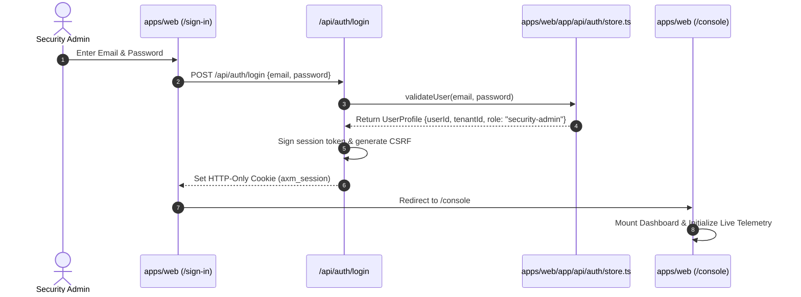

---

## Flow 2: Console Dashboard Loading & Live SSE Telemetry

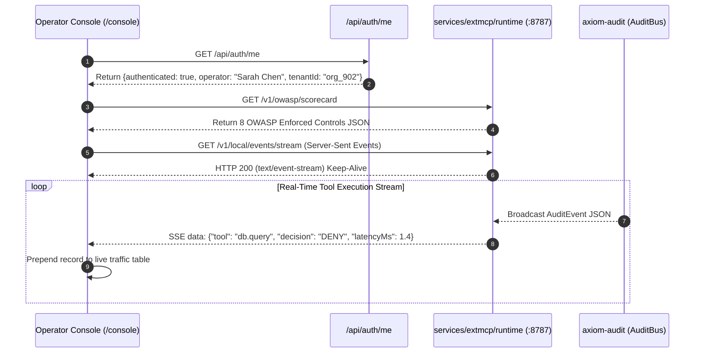

---

## Flow 3: Multi-Cloud Discovery & Inventory Ingestion

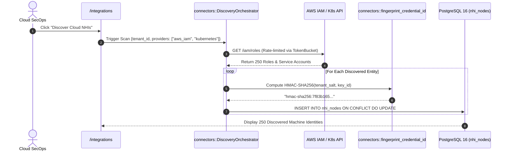

---

## Flow 4: Multi-Signal Ownership Attribution

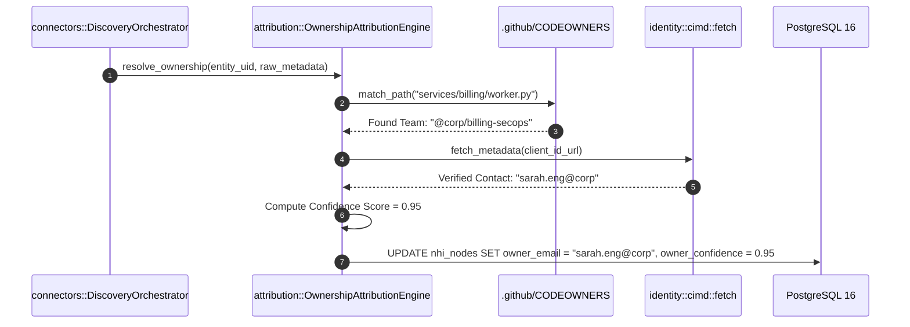

---

## Flow 5: Pre-Revocation Blast-Radius Simulation

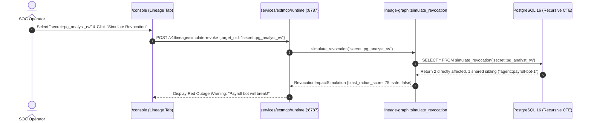

---

## Flow 6: Interactive Playground Security Evaluation

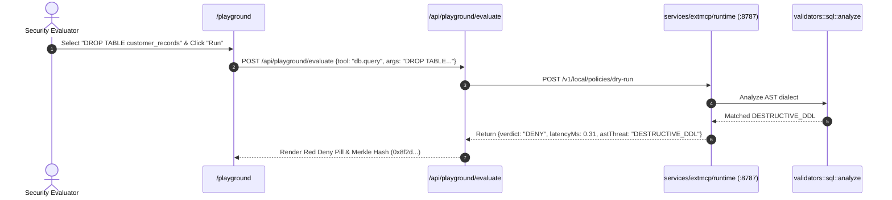

---

## Flow 7: Inline Tool Call Interception & AST Defense (<2ms Hot Path)

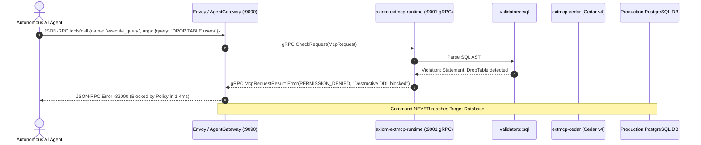

---

## Flow 8: Cedar Policy Dry-Run Evaluation

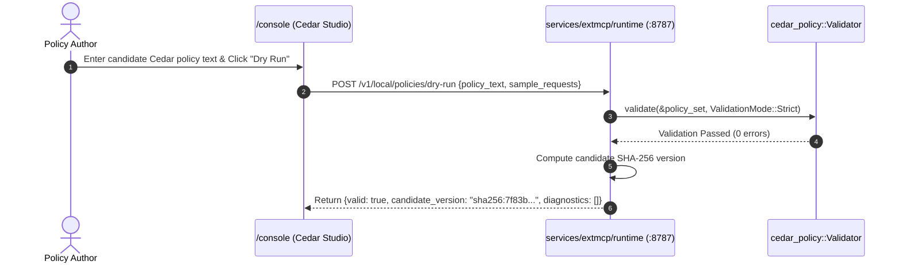

---

## Flow 9: Atomic Policy Bundle Hot-Swap (`ArcSwap`)

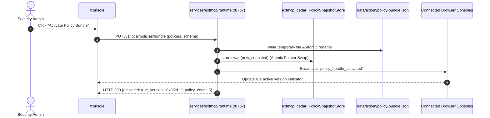

---

## Flow 10: Sub-50ms Emergency Kill-Switch Revocation

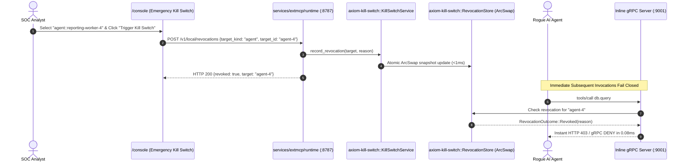

---

## Flow 11: Dynamic Secretless Credential Issuance (OpenBao)

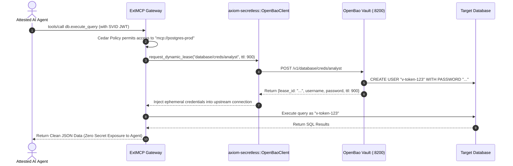

---

## Flow 12: Cryptographic Audit Event Streaming & SIEM Dispatch

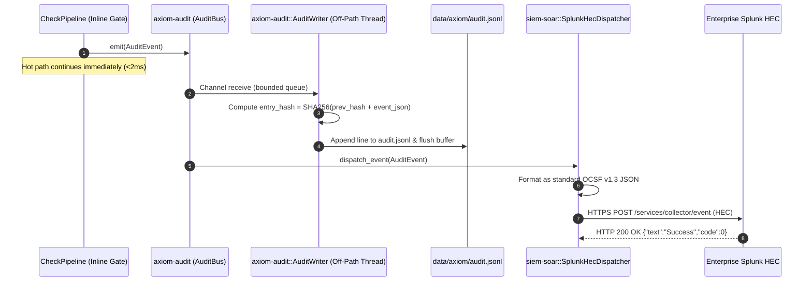
