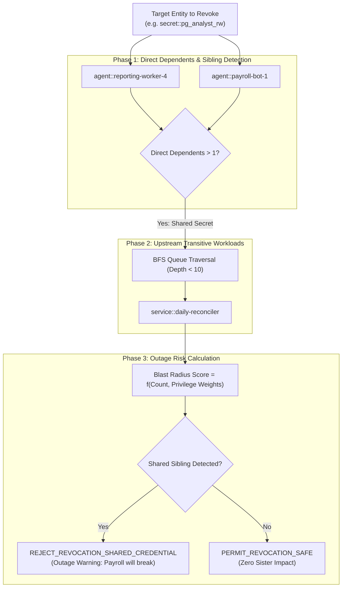

# Axiom NHI — Graph Lineage, Attribution & Risk Engine Specification

**Document:** `docs/architecture/complete-audit/GRAPH_AND_RISK_ENGINE.md`  
**Classification:** Graph Topology, Dependency Analysis & Mathematical Risk Calculations  
**Primary Crates:** `lineage-graph`, `attribution`, `risk-engine`  

---

## 1. Lineage Graph Architecture & Traversal

The Axiom NHI lineage graph models the relationships between humans, AI agents, credentials, workloads, and target infrastructure. It exists in two formats:
1. **Persistent Relational Graph:** Stored in PostgreSQL 16 (`nhi_nodes` and `nhi_edges`).
2. **In-Memory High-Speed Traversal Engine:** Implemented in `lineage-graph/src/lib.rs` using `LineageGraphEngine` with breadth-first search (BFS) queues for sub-millisecond pre-revocation simulation.

### 1.1 Node & Edge Taxonomy

```
[Human Owner] --(OWNS)--> [AI Agent] --(USES_CREDENTIAL)--> [Shared Secret] --(GRANTS_ACCESS_TO)--> [Database]
                               |
                               +--(CALLS_TOOL)--> [MCP Tool Server]
```

- **Nodes (`GraphNode`):**
  - `entity_uid`: Immutable canonical string (`agent::reporting-worker-4`, `db::prod-aurora-cluster`).
  - `entity_kind`: `HUMAN_OWNER`, `AI_AGENT`, `SERVICE_ACCOUNT`, `SHARED_CREDENTIAL`, `DATABASE`, `MCP_SERVER`.
  - `privilege_weight`: Numeric privilege ranking:
    - `10`: Read-only queries, metrics inspection, read files.
    - `25`: Scoped write, update, patch records.
    - `45`: Destructive DDL (`DROP`, `TRUNCATE`), root cluster admin, secret export.
- **Edges (`GraphEdge`):**
  - `relation_type`: `OWNS`, `USES_CREDENTIAL`, `GRANTS_ACCESS_TO`, `DELEGATES_TO`, `CALLS_TOOL`.
  - `observed_via`: `github_codeowners`, `otel_span_inspection`, `cloud_iam_sync`.

---

## 2. Pre-Revocation Blast-Radius Simulation Algorithm

When an operator considers revoking a rogue agent or compromised secret, `lineage-graph::simulate_revocation` executes a two-phase traversal:



### Simulation Output Contract (`RevocationImpactSimulation`):
```rust
pub struct RevocationImpactSimulation {
    pub target_uid: String,
    pub safe_to_revoke_immediately: bool,
    pub directly_affected_agents: Vec<String>,
    pub transitively_affected_workloads: Vec<String>,
    pub shared_credential_siblings: Vec<String>,
    pub blast_radius_score: u8,
    pub recommended_action: String,
}
```

---

## 3. Mathematical Risk Calculations & Scoring Formulas

The `risk-engine` crate (`risk-engine/src/lib.rs`) evaluates telemetry against all **10 OWASP NHI Top 10 (2025)** and **10 OWASP MCP Top 10 (2025)** controls.

### 3.1 Severity Weights
Every detected finding is assigned a weight based on `FindingSeverity`:
- **Critical:** 30 points
- **High:** 18 points
- **Medium:** 8 points
- **Low / Info:** 3 points

### 3.2 Exposure Score Formula
The total exposure score is computed by summing all active finding weights, capped at 100:
$$\text{TotalWeight} = \sum_{f \in \text{findings}} \text{Weight}(f)$$
$$\text{ExposureScore} = \min(100, \text{TotalWeight})$$

**Unowned Shadow NHI Floor Guarantee:**
If an identity lacks a verified human owner (`!telemetry.has_active_owner`), the engine imposes a mandatory risk floor:
$$\text{ExposureScore} = \max(75, \text{ExposureScore})$$

### 3.3 Composite Severity Formula
The composite risk combines the identity's exposure with the blast-radius score derived from the lineage graph using a 60/40 ratio:
$$\text{RawComposite} = \left\lfloor \frac{(\text{ExposureScore} \times 6) + (\text{BlastRadiusScore} \times 4)}{10} \right\rfloor$$

### 3.4 Composite Severity Mapping Matrix

| Maximum Finding Severity | Exposure Score | Blast Radius Score | Composite Severity |
|---|---|---|---|
| **Critical** | $\ge 50$ | OR $\ge 40$ | **CRITICAL** |
| **Critical** | $< 50$ | AND $< 40$ | **HIGH** |
| **High** | $\ge 60$ | OR $\text{RawComposite} \ge 50$ | **HIGH** |
| **High** | $< 60$ | AND $\text{RawComposite} < 50$ | **MEDIUM** |
| **Medium** | N/A | $\text{RawComposite} \ge 40$ | **MEDIUM** |
| **Low / Info** | N/A | N/A | **LOW** |

---

## 4. Evaluated Control Catalogs

### 4.1 OWASP NHI Top 10 (2025) Controls
1. **`NHI1:2025`:** Improper Offboarding & Dormant NHIs (>90 days inactivity).
2. **`NHI2:2025`:** Secret Leakage in Plaintext Configuration or Git Commits.
3. **`NHI3:2025`:** Long-Lived Static API Tokens without Dynamic Rotation.
4. **`NHI4:2025`:** Over-Privileged Machine Access & Wildcard Policies (`:*`).
5. **`NHI5:2025`:** Cloud Metadata SSRF & Insecure Egress.
6. **`NHI6:2025`:** Missing Cryptographic Payload Integrity on Approvals.
7. **`NHI7:2025`:** Unchecked Cross-Tenant Lineage & Multi-Hop Impersonation.
8. **`NHI8:2025`:** Cross-Environment Credential Sharing (Dev shared with Prod).
9. **`NHI9:2025`:** Credential Reuse Across Multiple Disjoint Workloads.
10. **`NHI10:2025`:** Human Interactive Use of Machine/NHI Service Tokens.

### 4.2 OWASP MCP Top 10 (2025) Controls
1. **`MCP01:2025`:** Token Mismanagement & Query-String Exposure.
2. **`MCP02:2025`:** Privilege Escalation via Agent Scope Creep.
3. **`MCP03:2025`:** Tool Definition Tampering & Golden Schema Drift.
4. **`MCP04:2025`:** Software Supply Chain Risks in MCP Packages.
5. **`MCP05:2025`:** Command & SQL Injection via Tool Arguments.
6. **`MCP06:2025`:** Context Leakage via Autonomous Tool Prompts.
7. **`MCP07:2025`:** Missing RFC 8707 Resource Indicator Audience Binding.
8. **`MCP08:2025`:** Unaudited Tool Execution Bypassing OTel Telemetry.
9. **`MCP09:2025`:** Shadow / Unregistered External MCP Tool Servers.
10. **`MCP10:2025`:** Cross-Tenant Memory & Prompt Context Bleed.
