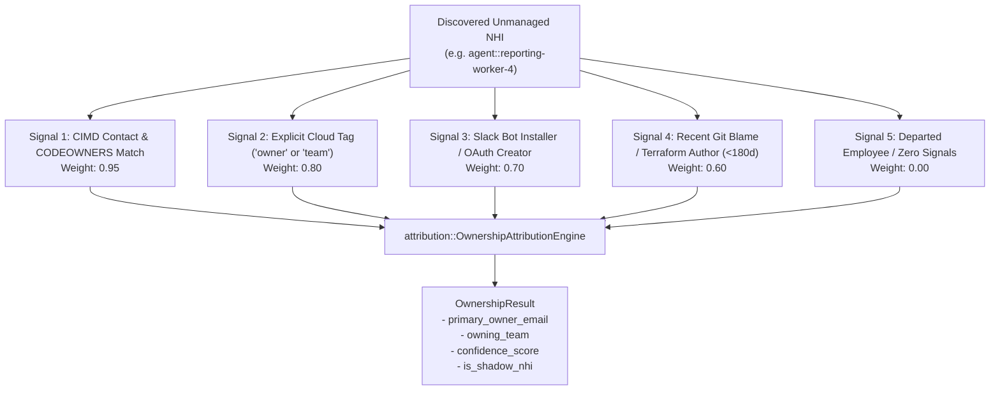

# Axiom NHI — Identity Discovery & Normalization Specification

**Document:** `docs/architecture/complete-audit/IDENTITY_DISCOVERY.md`  
**Classification:** NHI Ingestion, Entity Resolution & Canonical Modeling  
**Primary Crates:** `connectors`, `identity`, `attribution`, `lineage-graph`  

---

## 1. Identity Definition & Normalization

In Axiom NHI, an **Identity** is defined as any autonomous or automated entity that initiates or receives API calls, executes tool functions, or holds credentials capable of accessing enterprise resources.

### 1.1 Canonical Entity UID Scheme
Every discovered identity is assigned an immutable, namespaced canonical UID:
- **AI Agents:** `agent::<agent-identifier>` (e.g. `agent::reporting-worker-4`, `agent::pr-summarizer`)
- **Cloud IAM Roles:** `iam::aws::<account-id>/<role-name>` (e.g. `iam::aws::123456789012/DataPipelineRole`)
- **Kubernetes Workloads:** `k8s::<cluster>/<namespace>/sa/<serviceaccount-name>`
- **GitHub Entities:** `github::org/<org-name>/repo/<repo-name>/action/<runner-id>`
- **Slack Bots:** `slack::team/<team-id>/bot/<bot-id>`
- **Shared Credentials:** `secret::<provider>/<credential-name>` (e.g. `secret::openbao/database/creds/analyst`)
- **Target Resources:** `mcp://<canonical-domain>/<tool-name>` or `db::<cluster-name>`
- **Human Owners:** `human::<email-address>`

---

## 2. Ingestion Contracts Comparison

The monorepo reconciles three distinct layers of data structures during ingestion:

| Field | Discovery Ingestion (`DiscoveredNode`) | Database Schema (`nhi_nodes`) | Memory Graph (`GraphNode`) |
|---|---|---|---|
| **Identifier** | `entity_uid: String` | `entity_uid TEXT PRIMARY KEY` | `entity_uid: String` |
| **Type** | `entity_kind: String` | `entity_kind TEXT NOT NULL` | `entity_kind: String` |
| **Origin** | `source_connector: ConnectorKind` | `source_connector TEXT NOT NULL` | N/A |
| **Label** | `display_name: String` | `display_name TEXT NOT NULL` | `display_name: String` |
| **Secret Hash** | `fingerprint_sha256: String` | `fingerprint_sha256 TEXT NOT NULL`| N/A |
| **Owner** | Resolved via `attribution` | `owner_email TEXT`, `owning_team TEXT` | `owner_email: Option<String>` |
| **Risk Metrics** | N/A | `exposure_score`, `blast_radius_score` | `privilege_weight: u8` |
| **Flags** | N/A | `owasp_nhi_flags TEXT[]`, `owasp_mcp_flags TEXT[]` | N/A |
| **Tags** | `metadata_tags: HashMap<String, String>`| `metadata JSONB` | N/A |

---

## 3. Deduplication & Entity Resolution

### 3.1 Resolving Duplicate Identities
When the same workload is discovered across multiple disconnected systems (e.g. an AI agent deployed on Kubernetes that also connects to GitHub and uses an AWS IAM role):
1. **Primary Key Match:** If the `entity_uid` matches exactly, the node is updated via `UPSERT` (`INSERT ... ON CONFLICT (entity_uid) DO UPDATE`).
2. **Credential Fingerprint Match:** If two disparate nodes share an identical `fingerprint_sha256` value, the system does **not** merge them into a single node. Instead, it flags them as an **`NHI9:2025` Credential Sharing Condition** and establishes a `USES_CREDENTIAL` edge to the same shared credential node.
3. **CIMD Resolution:** If the agent provides an OAuth 2.1 `client_id` formatted as an HTTPS URL (`https://agents.acme.corp/metadata/worker-4`), the `identity` crate fetches the Client ID Metadata Document (CIMD), extracts canonical contact metadata, and links the identity to verified human owners.

---

## 4. Multi-Signal Ownership Attribution Algorithm

The `attribution` crate (`attribution/src/lib.rs`) determines the true human owner of an unmanaged machine identity using a weighted Bayesian scoring engine:

### Attribution Confidence Thresholds:
- **`confidence_score >= 0.80`:** High-confidence attribution. Owner is automatically populated in PostgreSQL and displayed in `/console`.
- **`0.40 <= confidence_score < 0.80`:** Probabilistic attribution. Flagged for operator confirmation.
- **`confidence_score < 0.40` or owner departed:** Classified as **Shadow NHI (`is_shadow_nhi = true`)**. Automatically triggers an **`NHI1:2025`** exposure finding in the risk engine.
