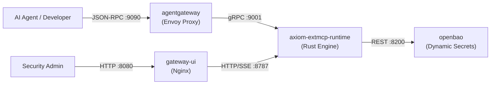

# Axiom NHI — Complete Infrastructure & Deployment Runbook

**Document:** `docs/architecture/complete-audit/INFRASTRUCTURE_AND_DEPLOYMENT.md`  
**Classification:** DevOps, Container Orchestration & Production Runbook  
**Environments:** Local Dev, Docker Compose, Kubernetes (Helm), Air-Gapped VPC  

---

## 1. Local Development Setup (Quickstart)

### 1.1 Prerequisites
- **Node.js:** `>= 20.0.0`
- **pnpm:** `>= 9.15.0`
- **Rust Toolchain:** `1.80.0+` (stable with `cargo` and `rustc`)
- **Docker & Docker Compose:** Optional for containerized dependencies (OpenBao, PostgreSQL 16)

### 1.2 Step-by-Step Local Commands (Windows PowerShell)

```powershell
# 1. Clone & Enter Repository
git clone https://github.com/GurnoorBagga17/New.git Axiom
cd Axiom

# 2. Install TypeScript & Monorepo Dependencies
pnpm install

# 3. Verify Rust Workspace Crates Compile
cargo check --workspace

# 4. Start the ExtMCP Rust Runtime in Dev Mode
$env:AXIOM_DEV_MODE="1"
$env:AXIOM_ALLOW_ANONYMOUS_LOCAL="1"
$env:AXIOM_IDENTITY_CONFIG="deployments/local/identity.json"
$env:AXIOM_RESOURCE_MAP_CONFIG="deployments/local/resources.json"
$env:AXIOM_VALIDATION_CONFIG="deployments/local/validation.json"
$env:AXIOM_REVOCATION_CONFIG="deployments/local/revocations.json"
$env:AXIOM_ADMIN_TOKEN="0123456789abcdef0123456789abcdef"
$env:AXIOM_DATA_DIR="./data/axiom-dev"

cargo run -p extmcp-runtime

# 5. In a Separate Terminal, Start Next.js Cloud Control Plane
cd apps/web
pnpm dev
# Accessible at http://localhost:3000 (Console at http://localhost:3000/console)
```

### 1.3 Step-by-Step Local Commands (Linux / macOS)

```bash
# 1. Clone & Install
git clone https://github.com/GurnoorBagga17/New.git Axiom && cd Axiom
pnpm install

# 2. Build & Run ExtMCP Runtime
export AXIOM_DEV_MODE=1
export AXIOM_ALLOW_ANONYMOUS_LOCAL=1
export AXIOM_IDENTITY_CONFIG=deployments/local/identity.json
export AXIOM_RESOURCE_MAP_CONFIG=deployments/local/resources.json
export AXIOM_VALIDATION_CONFIG=deployments/local/validation.json
export AXIOM_REVOCATION_CONFIG=deployments/local/revocations.json
export AXIOM_ADMIN_TOKEN="0123456789abcdef0123456789abcdef"
export AXIOM_DATA_DIR="./data/axiom-dev"

cargo run -p extmcp-runtime &

# 3. Start Next.js App
pnpm --filter @axiom/web dev
```

---

## 2. Docker & Containerized Deployments

### 2.1 Multi-Container Compose Stack (`deployments/docker/docker-compose.yml`)

The production Docker Compose stack coordinates four isolated container services:
1. **`extmcp` (`axiom-extmcp-runtime`):** Rust security engine exposing gRPC on port `9001` and HTTP/SSE admin on port `8787`.
2. **`agentgateway` (Envoy Proxy):** High-speed MCP proxy intercepting client traffic on port `9090` and calling `extmcp` over gRPC.
3. **`openbao` (Dynamic Vault):** Dynamic secret broker running in an isolated MPL-2.0 container on port `8200`.
4. **`gateway-ui`:** Nginx alpine container serving the compiled operator console on port `8080`.

```bash
# Launch the complete local container stack
docker compose -f deployments/docker/docker-compose.yml up -d
```

### 2.2 Container Topology



---

## 3. Production Kubernetes Deployment (Helm & CRDs)

The official enterprise deployment package includes Custom Resource Definitions (CRDs) and Helm charts:

### 3.1 Kubernetes Custom Resource Definitions (CRDs)
Located in `deployments/kubernetes/crds/`:
- **`AxiomPolicyBundle` (`axiom.io/v1alpha1`):** Declarative representation of Cedar policy sets, target agent roles, AST validator rules, and active bundle versions (`candidate_version`). Enables GitOps policy synchronization via ArgoCD or Flux.
- **`AxiomMcpServer` (`axiom.io/v1alpha1`):** Declarative registration of upstream MCP servers, tool definitions, cryptographic tool hash pins (`RFC 8785`), secretless broker provider references, and per-tool Cedar constraints.

### 3.2 Helm Chart Templates (`deployments/helm/axiom-nhi/`)
- **`daemonset-runtime.yaml`:**
  - Deploys `axiom-extmcp-runtime` as a node-level DaemonSet to service local agent workloads with sub-millisecond network latency.
  - Mounts the host-level SPIFFE CSI driver socket (`/run/spire/sockets/agent.sock`) for zero-touch workload SVID attestation.
  - Exposes port `9001` (gRPC inline filter) and port `8787` (HTTP/SSE control plane) with automated `/healthz` probes.
- **`mutating-webhook.yaml`:**
  - Configures a Mutating Admission Webhook (`axiom-sidecar-injector.axiom-system.svc`) targeting pods annotated with `axiom.io/inject: "true"`.
  - Injects the `axiom-agentgateway` Envoy sidecar container, routing outbound tool calls transparently to the node-local DaemonSet on `:9001`.
- **`deployment-gateway-and-airgap.yaml`:**
  - Deploys high-availability control plane pods with pod anti-affinity.
- **`statefulsets-and-services.yaml`:**
  - Provisions PostgreSQL 16 cluster with multi-tenant RLS schema and Redis session cache.
- **`external-secrets.yaml`:**
  - Synchronizes operator credentials and cloud provider keys via external vault engines.

```bash
# Install CRDs
kubectl apply -f ./deployments/kubernetes/crds/

# Install via Helm in corporate Kubernetes cluster
helm upgrade --install axiom-nhi ./deployments/helm/axiom-nhi \
  --namespace axiom-system \
  --create-namespace \
  --values ./deployments/helm/axiom-nhi/values.yaml
```

---

## 4. Air-Gapped & VPC-Isolated Operation

For defense, intelligence, and heavily regulated banking environments, Axiom NHI can operate in **100% offline, air-gapped mode**:
1. **Pre-warmed JWKS Keys:** Issuer public keys can be stored statically in `deployments/local/identity.json` without requiring live outbound HTTPS calls to Okta or Google.
2. **Zero External Telemetry:** All audit logs are written locally to append-only JSONL files (`audit.jsonl`).
3. **Internal Container Registry:** All images (`Dockerfile.extmcp`, `Dockerfile.agentgateway`) use distroless or alpine bases that can be mirrored into private enterprise registries (Harbor, AWS ECR).
