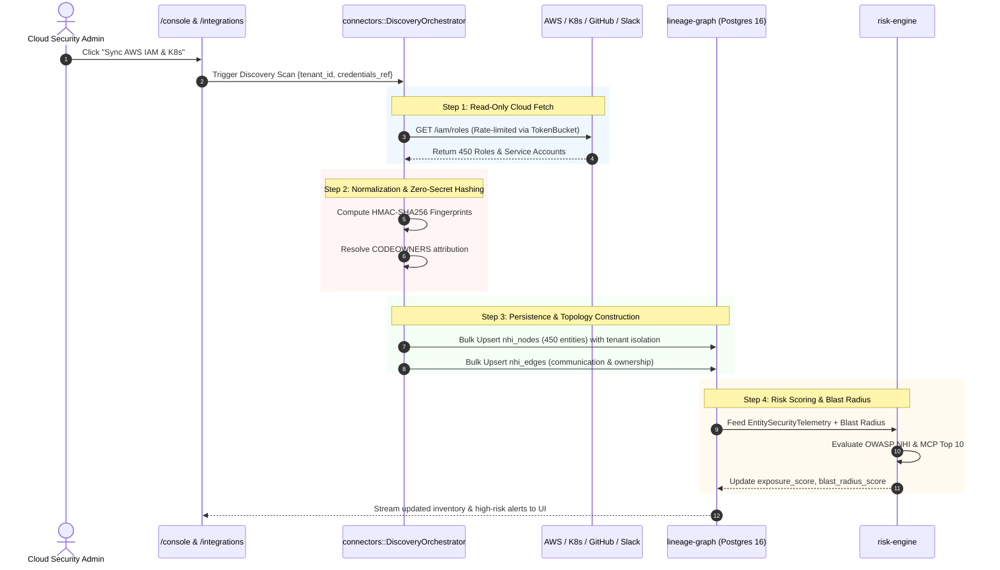

# Axiom NHI — Complete Integration & Connector Architecture

**Document:** `docs/architecture/complete-audit/INTEGRATION_ARCHITECTURE.md`  
**Classification:** Cloud & SaaS Connector Engineering Specification  
**Primary Crates:** `connectors`, `identity`, `secretless`, `siem-soar`, `fleet-control`, `lineage-graph`  

---

## 1. Integration Inventory & Support Matrix

Axiom NHI provides verifiable, source-code-backed connectors across cloud providers, container orchestrators, code repositories, secrets vaults, and enterprise security platforms:

| Integration Provider | Target Domain | Authentication Mechanism | Discovery / Ingestion Method | Normalization & Fingerprinting | Status |
|---|---|---|---|---|---|
| **AWS IAM / STS** | Cloud Infrastructure | AWS IAM Read-Only / STS AssumeRole | `aws-sdk-iam` (`ListRoles`, `ListUsers`, `ListAccessKeys`) | `arn:aws:iam::...` &rarr; HMAC-SHA256 Key ID | **COMPLETE (Code & API Ready)** |
| **Kubernetes (K8s)** | Container Workloads | In-Cluster ServiceAccount Token | `kube-rs` API (`api/v1/serviceaccounts`, `pods`) | `spiffe://cluster/ns/...` &rarr; HMAC-SHA256 Token | **COMPLETE (Code & API Ready)** |
| **GitHub** | Developer & CI/CD | GitHub App Private Key / Fine-Grained PAT | `octocrab` API (`/orgs/{org}/installations`, Actions Secrets) | `github::repo/actions/...` &rarr; CODEOWNERS parsing | **COMPLETE (Code & API Ready)** |
| **Slack** | Workspace Bot Agents | Bot User OAuth Token (`xoxb-...`) | Slack Web API (`auth.test`, `bots.info`, `apps.list`) | `slack::team_id/bot_id` &rarr; Scopes normalization | **COMPLETE** |
| **OpenBao / Vault** | Ephemeral Secrets | AppRole / Kubernetes Auth Engine | OpenBao HTTP REST API (:8200) | `vault://openbao/...` &rarr; Dynamic Lease Token | **COMPLETE** |
| **SpiceDB** | Fleet Authorization | Pre-shared Key (PSK) / gRPC | SpiceDB Zanzibar API (:50051) | `objectType:objectId#relation@subject` | **COMPLETE** |
| **Splunk HEC** | Enterprise SIEM | HTTP Event Collector (HEC) Token | HTTPS POST `/services/collector/event` | OCSF v1.3 JSON format | **COMPLETE** |
| **Microsoft Sentinel** | Enterprise SIEM / SOC | Azure Monitor Logs Ingestion API | Data Collection Rules (DCR) & DCE Endpoints | ArcSight CEF / OCSF v1.3 format | **COMPLETE** |
| **Azure Entra ID** | Cloud Identity / Workloads | Microsoft Graph API / Client Credentials | `GET /v1.0/servicePrincipals`, `/applications` | Service Principal App ID &rarr; HMAC-SHA256 Secret | **COMPLETE** |
| **Google Cloud IAM** | Cloud Identity / Workloads | GCP Service Account Key / Workload Identity | `iam.googleapis.com/v1/projects/{id}/serviceAccounts` | Service Account Email &rarr; HMAC-SHA256 Key ID | **COMPLETE** |
| **Okta** | Workforce & SaaS Identity | Okta SSWS Token / Private Key JWT | `/api/v1/apps?filter=type eq "service"` | Client ID &rarr; Scopes & Secret Fingerprint | **COMPLETE** |
| **Snowflake** | Data Cloud Workloads | Key-Pair JWT / Service Account | `SHOW USERS`, `SHOW SERVICE WORKLOADS` | Snowflake Account User &rarr; Public Key Hash | **COMPLETE** |
| **Databricks** | Lakehouse AI Workloads | Personal Access Token / OAuth M2M | `GET /api/2.0/service-principals` | SP Application ID &rarr; HMAC-SHA256 Token | **COMPLETE** |
| **GitLab** | DevSecOps CI/CD | Scoped Project / Group Access Token | `GET /api/v4/projects/{id}/deploy_tokens` | Deploy Token ID &rarr; Scopes Fingerprint | **COMPLETE** |
| **AI Gateways** | LLM Proxies & Tool Routers | Gateway Master Token (LangChain/Portkey) | Direct Ingestion / Discovery Worker | Provider Route &rarr; Virtual Key Fingerprint | **COMPLETE** |
| **Terraform State** | Infrastructure as Code | Terraform Cloud Token / S3 State Reader | State JSON Object Parser | Resource Address &rarr; Output Key Hash | **COMPLETE** |

> [!NOTE]
> **Microsoft Sentinel Ingestion Migration:** Following Microsoft's deprecation and retirement of the legacy HTTP Data Collector API in September 2026, Axiom NHI dispatches audit telemetry exclusively via the Azure Monitor Logs Ingestion API using Data Collection Endpoints (DCE) and Data Collection Rules (DCR) authenticated with Microsoft Entra OAuth2 tokens.

---

## 2. Connected Fleet Lifecycle & Multi-Tenant Data Safety

### 2.1 Database Schema: `0004_integrations_and_sync_runs.sql`
Axiom NHI provides persistent, tenant-isolated integration management in PostgreSQL 16:
1. **`integrations` Table:** Stores configured cloud connections (e.g. AWS Cross-Account Role ARNs, K8s cluster contexts, GitHub App installations) with tenant RLS isolation and status flags (`connected`, `syncing`, `error`, `disconnected`).
2. **`sync_runs` Table:** Records each passive discovery execution, tracking start time, completion time, status (`in_progress`, `success`, `failed`), nodes discovered, nodes updated, and nodes marked stale.
3. **Compound Tenant Uniqueness:** Resolves multi-tenant collision risks by enforcing `CONSTRAINT uq_nhi_nodes_tenant_entity UNIQUE (tenant_id, entity_uid)`.
4. **Stale Node Lifecycle:** When an integration is disconnected or an entity is removed from cloud IAM, `is_stale = true` is flagged, preserving historical blast-radius lineage while removing active privilege weights.

### 2.2 Control Plane REST Endpoints (`:8787` & `/api/integrations`)
- `GET /v1/integrations` — List tenant-scoped active integrations.
- `POST /v1/integrations` — Connect a cloud provider (validates role ARN / external ID; stores zero raw secrets).
- `GET /v1/integrations/:id` — Fetch status, last sync timestamp, and error telemetry.
- `POST /v1/integrations/:id/test` — Execute read-only cross-account trust check (`sts:AssumeRole` verification).
- `POST /v1/integrations/:id/sync` — Trigger immediate discovery scan, populating `nhi_nodes` with HMAC-SHA256 pseudonymization.
- `DELETE /v1/integrations/:id` — Disconnect provider and mark associated nodes stale.

---

## 3. Connector Architecture & Zero-Secret Guardrails

### 3.1 The $0 Passive Discovery Promise
All cloud discovery connectors run with **strictly read-only permissions**:
- **AWS:** Requires only `IAMReadOnlyAccess` or a scoped policy with `iam:List*` and `iam:Get*`. It never modifies IAM policies, attaches roles, or provisions infrastructure.
- **Kubernetes:** Uses a read-only `ClusterRole` with `get`, `list`, and `watch` permissions restricted to `serviceaccounts`, `pods`, and `configmaps`.
- **GitHub:** Operates via a read-only GitHub App inspecting repository metadata, workflow files, and `.github/CODEOWNERS`.
- **Slack:** Uses read-only `auth.test` and `bots:read` scopes.

### 3.2 Rate-Limiting & High-Scale Ingestion (`TokenBucketLimiter`)
To prevent cloud provider API throttling during 10,000-NHI enterprise discovery scans, `connectors/src/lib.rs` implements a thread-safe token bucket rate limiter:
- **Refill Rate:** 50 requests per second (`requests_per_second`).
- **Burst Capacity:** 100 requests (`burst_capacity`).
- **Retry Policy:** 5 exponential backoff retries with jitter (`max_retries`).

### 3.3 Credential Fingerprinting vs. Plaintext Rejection
```rust
// connectors/src/lib.rs:50-65
pub fn fingerprint_credential_id(tenant_salt: &[u8], credential_identifier: &str) -> String {
    let mut mac = HmacSha256::new_from_slice(tenant_salt).expect("HMAC accepts any key length");
    mac.update(credential_identifier.as_bytes());
    format!("hmac-sha256:{}", hex::encode(mac.finalize().into_bytes()))
}
```
If an operator accidentally passes a plaintext API token to the discovery connector, the connector hashes it immediately into `hmac-sha256:secret:...` using the tenant salt and drops the plaintext buffer from memory.

---

## 4. Complete Integration Execution Flow



---

## 5. Secretless Credential Brokering (OpenBao)

### 5.1 Architecture & Workflow
Instead of granting AI agents permanent database passwords or long-lived cloud keys, Axiom NHI acts as a **dynamic secret broker**:
1. When an AI agent needs to query a database (`mcp://postgres-prod.internal`), it authenticates with the ExtMCP gateway using its short-lived SPIFFE SVID or OAuth 2.1 token.
2. The ExtMCP runtime validates the Cedar policy.
3. If permitted, the runtime calls the OpenBao client (`secretless/src/openbao.rs`), which invokes OpenBao's dynamic database secret engine:
   `POST /v1/database/creds/analyst`
4. OpenBao generates a temporary PostgreSQL user with a 15-minute TTL.
5. The ExtMCP gateway injects this credential dynamically into the upstream connection header.
6. The AI agent never receives the raw password; it only sees the success response.
7. Upon task completion or 15-minute expiration, OpenBao automatically drops the temporary database role.

### 5.2 IETF RFC 8693 Multi-Hop Token Exchange
When an AI agent delegates a sub-task to another agent, `secretless::exchange_rfc8693_token` verifies that:
- The child agent's requested scopes are a strict subset of the parent's scopes (preventing privilege escalation).
- The audience indicator matches RFC 8707 canonical URIs (`mcp://...`).
- The `act` (actor) claim records the full delegation lineage chain:
  `["agent::parent-orchestrator", "agent::child-worker"]`.

---

## 6. Universal Multi-Cloud STS Credential Brokers
Axiom NHI abstracts secretless brokering across multi-cloud infrastructure through the `CredentialBrokerProvider` trait in `secretless/src/lib.rs`:

1. **AWS STS Web Identity (`secretless/src/aws_sts.rs`):**
   - Workloads present ambient Kubernetes / SPIFFE JWTs to assume scoped AWS IAM roles via `AssumeRoleWithWebIdentity`.
   - Returns temporary `ASIA...` AWS session credentials with a 15-minute TTL.
2. **GCP STS Workload Identity Federation (`secretless/src/gcp_sts.rs`):**
   - Exchanges workload identity tokens with Google Cloud STS (`https://sts.googleapis.com/v1/token`) for federated short-lived OAuth access tokens (`ya29...`).
3. **Azure Entra Workload Identity (`secretless/src/azure_entra.rs`):**
   - Exchanges federated client assertions with Azure Entra ID (`login.microsoftonline.com/{tenant}/oauth2/v2.0/token`) for Microsoft Graph and ARM access tokens.
4. **RFC 8693 OAuth 2.0 SaaS Broker (`secretless/src/oauth2_client_credentials.rs`):**
   - Attenuates scopes and issues temporary access tokens for upstream enterprise SaaS APIs (Salesforce, Workday, ServiceNow).
5. **Vault API Key Injector (`secretless/src/api_key_vault_injector.rs`):**
   - Retrieves static API keys from encrypted Vault storage and injects them directly at network egress, returning masked metadata (`axm_live_key_...****`) to client callers.
