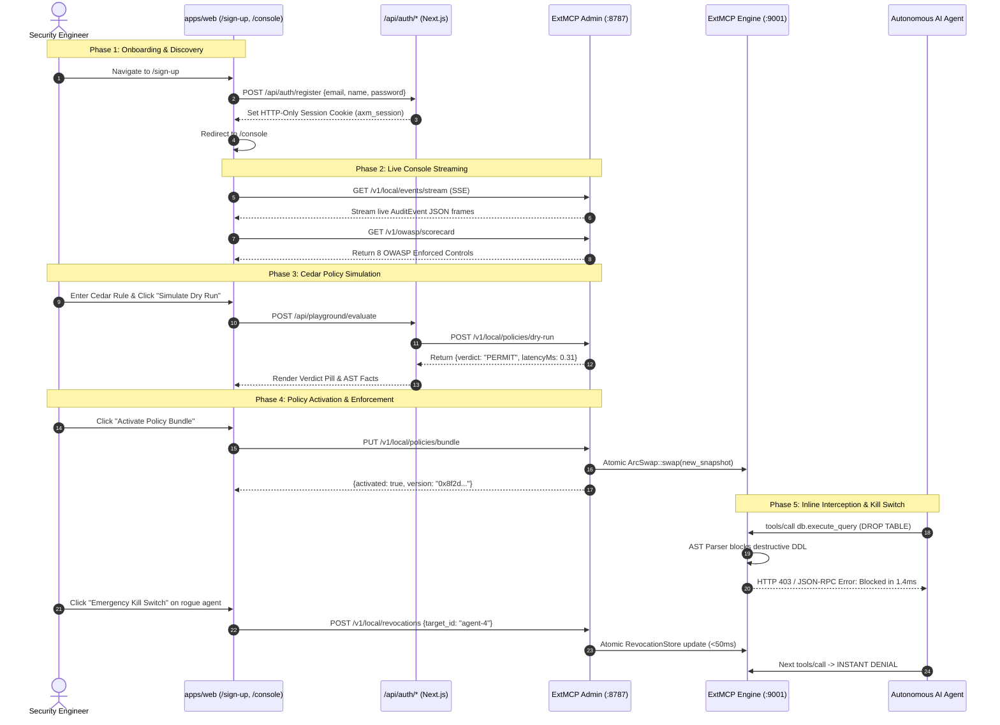

# Axiom NHI — Product Overview, Capabilities & User Journey

**Document:** `docs/architecture/complete-audit/PRODUCT_OVERVIEW.md`  
**Classification:** Core Product Intelligence & Functional Architecture  
**Monorepo Location:** Root, `apps/web/`, `apps/gateway-ui/`, `services/extmcp/runtime/`  

---

## 1. Product Overview: The Non-Human Identity (NHI) Challenge

### 1.1 What Problem Does Axiom NHI Solve?
In traditional enterprise cybersecurity, access management is centered on **human identities** using Single Sign-On (SSO), Multi-Factor Authentication (MFA), and role-based access control (RBAC). However, the explosive rise of microservices, cloud automation, CI/CD pipelines, and—most critically—**autonomous AI agents** (running via Claude Desktop, Cursor, LangChain, AutoGen, and MCP tool servers) has inverted the identity landscape.

Today, **non-human identities outnumber human identities by 45 to 1** in modern cloud enterprises. When an enterprise connects an autonomous AI agent to an internal PostgreSQL database, AWS cloud infrastructure, or corporate Slack, they typically issue a static API key or IAM role. If that AI agent experiences a prompt injection attack, hallucinates a destructive SQL command (`DROP TABLE customer_records`), or attempts to read root Kubernetes secrets, the existing security perimeter fails completely because:
1. **The agent holds a valid API key.** The database sees a legitimate connection.
2. **There is no human in the loop.** The agent executes queries in milliseconds.
3. **Traditional firewalls do not inspect JSON-RPC arguments.** They cannot parse whether an agent's tool invocation contains destructive DDL or private subnet SSRF.
4. **Ownership is untracked.** When a token leaks or an agent misbehaves, security teams cannot identify which engineer deployed the bot or which workloads share that credential.

Axiom NHI solves this by acting as an **inline, sub-millisecond governance gateway and non-human identity lifecycle platform**. It intercepts every tool invocation in real time, inspects arguments using formal Cedar policies and SQL AST parsers, enforces atomic human-in-the-loop approvals, dynamically leases ephemeral credentials via OpenBao, and maps full dependency lineage across all cloud assets.

---

### 1.2 Human Identity vs. Non-Human Identity (NHI)

| Attribute | Human Identity | Non-Human Identity (NHI) | AI Agent Identity (Autonomous NHI) |
|---|---|---|---|
| **Primary Actor** | Employee, contractor, operator | Service account, cron job, Lambda | Autonomous LLM agent, MCP client |
| **Authentication** | Username, password, Okta MFA, FIDO2 | Static API key, X.509 cert, IAM role | OAuth 2.1 JWT, CIMD, SPIFFE SVID |
| **Session Lifetime** | 8 to 24 hours (interactive) | Months to years (often never rotated) | Ephemeral (seconds to minutes per session) |
| **Behavior Pattern** | Predictable, UI-driven, rate-limited | Deterministic, programmatic script | Non-deterministic, probabilistic, prompt-driven |
| **Blast Radius** | Constrained by human permissions | Often granted admin/wildcard scopes | Can autonomously chain multi-hop tool calls |
| **Offboarding** | Revoked immediately via HR trigger | Frequently orphaned ("Shadow NHI") | Ephemeral, generated ad-hoc by developers |

### 1.3 NHI Taxonomy Recognized by Axiom NHI
Based on source code definitions in `connectors/src/lib.rs` and `lineage-graph/src/lib.rs`:
- **AI Agent (`AI_AGENT`):** Autonomous LLM runtime executing tool calls via JSON-RPC / MCP (`agent::reporting-worker-4`, `agent::pr-summarizer`).
- **Service Account (`SERVICE_ACCOUNT`):** Kubernetes service accounts, Google Cloud service accounts, or GitLab CI runners.
- **Cloud IAM Role (`CLOUD_ROLE`):** AWS IAM roles, STS AssumeRole sessions, Azure Managed Identities.
- **Shared Credential (`SHARED_CREDENTIAL`):** Database passwords, static API tokens, or webhook secrets shared across multiple workloads (`NHI9:2025` risk).
- **Target Resource / MCP Server (`TARGET_RESOURCE`):** Upstream databases, GitHub repos, internal microservices, or MCP tool servers.
- **Human Owner (`HUMAN_OWNER`):** Corporate employee or engineering team attributed with ownership of the machine identity.

---

## 2. Core Value Proposition

1. **<5ms Inline Protection:** Evaluates every AI agent tool call (`tools/call`) using AWS Cedar v4 and Rust `sqlparser` AST in under 2ms—blocking destructive actions inline without degrading agent execution speed.
2. **Zero-Secret Invariant:** Secrets are never stored or logged in raw plaintext. The system uses HMAC-SHA256 fingerprinting for discovery and injects ephemeral, dynamically leased credentials at the network egress via OpenBao.
3. **$0 Passive Cloud Discovery:** Connects to AWS, Kubernetes, GitHub, and Slack using strictly read-only metadata APIs—discovering every unmanaged "Shadow NHI" with zero runtime infrastructure cost.
4. **Pre-Revocation Blast-Radius Simulation:** Uses recursive PostgreSQL 16 graph queries to model exactly which sister workloads will break before an operator triggers a credential revocation.
5. **Fail-Closed Governance:** Any engine timeout, network disruption, or parsing error defaults to `DENY`.

---

## 3. Product Capabilities Matrix

| Capability | Business Purpose | Technical Implementation | Frontend Location | Backend Location | Status |
|---|---|---|---|---|---|
| **Inline MCP Policy Gate** | Block dangerous tool calls before execution | Envoy / agentgateway ext_authz calling Rust gRPC `CheckRequest` | `apps/web/app/playground` & `/console` | `services/extmcp/runtime/src/main.rs`, `services/extmcp/cedar` | **COMPLETE** |
| **SQL AST Threat Filter** | Detect destructive DDL (`DROP`, `TRUNCATE`) | `sqlparser` AST dialect scanning | `apps/web/app/components/TerminalSimulator.tsx` | `validators/src/sql.rs`, `validators/src/adapter.rs` | **COMPLETE** |
| **Lock-Free Hot-Swap** | Update Cedar policies without restart | `arc_swap::ArcSwap` atomic pointer swap | `apps/gateway-ui` Policy Studio, `/console` | `services/extmcp/cedar/src/store.rs`, `services/extmcp/runtime/src/admin.rs` | **COMPLETE** |
| **Emergency Kill-Switch** | Sub-50ms instant revocation of agent sessions | Atomic revocation store + snapshot persistence | `/console` Emergency Kill Switch, `apps/gateway-ui` | `observability/kill-switch/src/service.rs`, `services/extmcp/runtime/src/admin.rs` | **COMPLETE** |
| **Real-Time Audit Streaming** | Live visibility into all agent traffic | Server-Sent Events (SSE) from Rust broadcast channel | `/console` Traffic Inspector, `apps/gateway-ui` TrafficStream | `services/extmcp/runtime/src/admin.rs`, `observability/audit` | **COMPLETE** |
| **Multi-Cloud Discovery** | Discover unmanaged NHIs across AWS, K8s, GitHub | Read-only API workers + HMAC-SHA256 fingerprinting | `/integrations`, `apps/gateway-ui` Connectors | `connectors/src/lib.rs`, `connectors/src/discovery.rs` | **COMPLETE** |
| **Lineage Graph Simulator** | Prevent breaking production when revoking credentials | Recursive SQL CTE blast-radius traversal | `/console` Lineage Tab, `apps/gateway-ui` LineageGraph | `lineage-graph/src/lib.rs`, `lineage-graph/migrations/0001_phase2_graph.sql` | **COMPLETE** |
| **Secretless Dynamic Broker** | Eliminate static, long-lived API tokens | OpenBao JIT leases + RFC 8693 token exchange | `/console` Secretless Tab, `apps/gateway-ui` Secretless | `secretless/src/lib.rs`, `secretless/src/openbao.rs` | **COMPLETE** |
| **OWASP Risk Engine** | Calculate exposure and compliance scores | Mathematical weighted scoring (OWASP NHI & MCP Top 10) | `/console` OWASP Scorecard, `/security` | `risk-engine/src/lib.rs` | **COMPLETE** |
| **Multi-Signal Attribution** | Find the real human owner of every agent | CODEOWNERS + CIMD + Cloud Tags + Git Blame | `apps/gateway-ui` Attribution | `attribution/src/lib.rs` | **COMPLETE** |
| **Atomic Human Approval** | Secure human approval for high-risk actions | Length-prefixed domain-separated SHA-256 tokens | `apps/gateway-ui` Approvals, Slack Webhook | `approvals/src/lib.rs`, `approvals/src/slack.rs` | **COMPLETE** |
| **SIEM / SOAR Dispatcher** | Stream security alerts to enterprise SOC | OCSF v1.3 and ArcSight CEF formatters | `/integrations`, `apps/gateway-ui` SIEM | `siem-soar/src/lib.rs`, `siem-soar/src/dispatcher.rs` | **COMPLETE** |
| **SpiceDB Fleet RBAC** | Causal multi-hop delegation chain revocation | SpiceDB Zanzibar relationships client | `apps/gateway-ui` Fleet | `fleet-control/src/spicedb.rs`, `fleet-control/src/lib.rs` | **COMPLETE** |

---

## 4. User Personas

1. **Security Administrator (SecOps / IAM Lead):**
   - *Goal:* Eliminate long-lived static tokens, enforce least privilege on autonomous agents, and maintain continuous compliance with OWASP NHI Top 10.
   - *Primary Surfaces:* `/console`, `/platform`, `/security`, `apps/gateway-ui/src/modules/policy-studio/`.
2. **Cloud Security Architect:**
   - *Goal:* Design zero-trust boundaries for multi-cloud deployments, ensure no plaintext secrets exist in configs, and configure OpenBao dynamic leases.
   - *Primary Surfaces:* `/integrations`, `/trust`, `deployments/helm/`, `services/extmcp/runtime/`.
3. **Platform / DevOps Engineer:**
   - *Goal:* Deploy the Axiom gateway container alongside Kubernetes MCP tool servers with zero application code changes and low latency overhead.
   - *Primary Surfaces:* `/docs`, `/playground`, `deployments/docker/`, `gateway/agentgateway/`.
4. **SOC Analyst / Incident Responder:**
   - *Goal:* Monitor live agent traffic streams, investigate anomalous tool invocations (prompt injections, unauthorized egress), and trigger emergency session revocations within 50ms.
   - *Primary Surfaces:* `/console` (Traffic Inspector, Emergency Kill Switch), `apps/gateway-ui/src/modules/traffic/`.

---

## 5. Complete User Journey (Step-by-Step Execution)

### Detailed Breakdown of Journey Stages:
1. **Public Discovery (`/` and `/playground`):**
   - User visits the homepage, reads architectural claims, and interacts with the `/playground` editor to test simulated attacks (SQL injection, path traversal, private IP egress).
2. **Registration & Session Establishment (`/sign-up`, `/sign-in`):**
   - User registers an account. Next.js route `/api/auth/register` creates an in-memory session (or connects to Supabase/OIDC), setting an encrypted HTTP-only cookie `axm_session`.
3. **Console Dashboard Access (`/console`):**
   - Browser checks authentication via `/api/auth/me`. If running in local dev mode (`AXIOM_DEV_MODE=1`), it provides immediate access to the operator profile.
   - The browser opens an `EventSource` connection to `http://127.0.0.1:8787/v1/local/events/stream`.
4. **Policy Authoring & Dry Run (`/console` Cedar Tab):**
   - User authors a Cedar rule. Clicking "Dry Run" sends a POST request to `/api/playground/evaluate`, which calls `POST http://127.0.0.1:8787/v1/local/policies/dry-run`.
   - The Rust engine parses the Cedar AST and validates it against the schema.
5. **Live Bundle Activation (`/console`):**
   - User clicks "Activate Policy Bundle". Axum admin handler `activate_bundle` validates the bundle, atomically swaps the `ArcSwap<PolicySnapshot>` in memory, and writes `policy-bundle.json` to disk.
   - Both the gRPC port `9001` and Axum port `8787` immediately reflect the new policy without dropping active TCP connections.
6. **Emergency Revocation (`/console` Kill Switch):**
   - User selects an agent UID (`agent::reporting-worker-4`) and clicks "Trigger Emergency Kill Switch".
   - The frontend issues `POST http://127.0.0.1:8787/v1/local/revocations`. The Rust `KillSwitchService` inserts a revocation record and saves a snapshot. Any subsequent tool call from that agent is rejected in <0.1ms.
