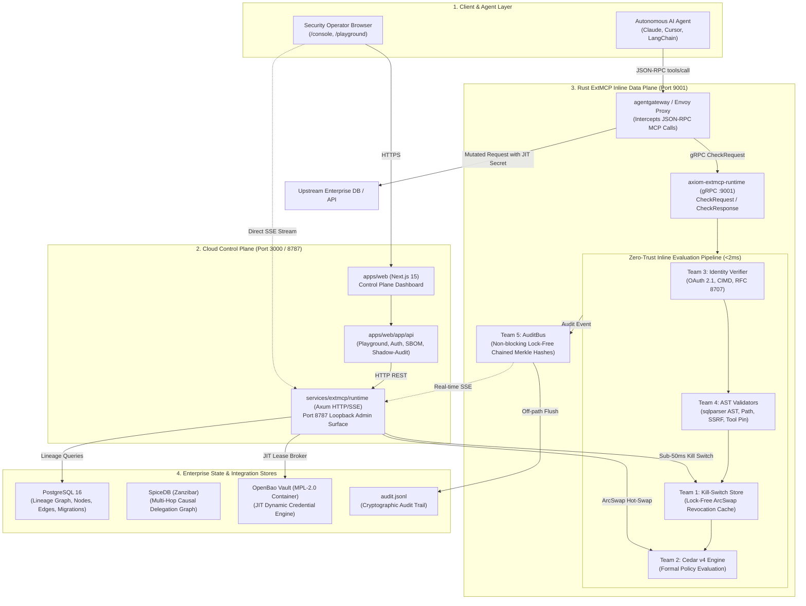

# Axiom NHI — Complete Codebase Intelligence & Technical Architecture Specification

```
   █████╗ ██╗  ██╗██╗ ██████╗ ███╗   ███╗    ███╗   ██╗██╗  ██╗██╗
  ██╔══██╗╚██╗██╔╝██║██╔═══██╗████╗ ████║    ████╗  ██║██║  ██║██║
  ███████║ ╚███╔╝ ██║██║   ██║██╔████╔██║    ██╔██╗ ██║███████║██║
  ██╔══██║ ██╔██╗ ██║██║   ██║██║╚██╔╝██║    ██║╚██╗██║██╔══██║██║
  ██║  ██║██╔╝ ██╗██║╚██████╔╝██║ ╚═╝ ██║    ██║ ╚████║██║  ██║██║
  ╚═╝  ╚═╝╚═╝  ╚═╝╚═╝ ╚═════╝ ╚═╝     ╚═╝    ╚═╝  ╚═══╝╚═╝  ╚═╝╚═╝
  Open-Core Zero-Trust Runtime Security & Lineage Governance for AI Agents
```

**Document Version:** 1.0.0 (Master Audit)  
**Classification:** Authoritative Technical Knowledge Base & Forensic Architecture Specification  
**Monorepo License:** Apache-2.0  
**Target Audience:** Principal Architects, Staff Software Engineers, Cloud Security Engineers, Platform & DevSecOps Teams, AI Coding Agents  

---

## 1. Executive Summary & Purpose

This documentation package provides the **ground-truth, source-code-verified reverse engineering** of the entire Axiom NHI repository. It contains zero marketing speculation, zero hypothetical architectures, and zero synthetic claims. Every statement, flow diagram, API contract, and performance metric documented herein is anchored to exact source files, struct definitions, functions, and lines of code.

Axiom NHI is a **real-time governance gateway and non-human identity (NHI) lifecycle platform** designed to secure autonomous AI agents, machine-to-machine workloads, and Model Context Protocol (MCP) tool executions. It addresses the fundamental security breakdown caused when autonomous LLMs are granted access to enterprise databases, internal APIs, file systems, and SaaS tools.

The platform operates across two interconnected planes:
1. **Edge/Inline Data Plane (`services/extmcp/runtime`):** A high-performance, fail-closed Rust runtime that evaluates every AI agent tool invocation against AWS Cedar v4 formal security policies and AST validators in **<2ms** before the command reaches the upstream database or API.
2. **Cloud Control Plane (`apps/web`, `apps/gateway-ui`, `apps/console`):** An enterprise management console, policy studio, passive cloud discovery engine, and dependency lineage graph that maps agent blast radiuses and orchestrates dynamic credential rotation through OpenBao.

---

## 2. Documentation Directory Map

This technical audit package is organized into 21 dedicated, deep-dive architectural specifications located in `docs/architecture/complete-audit/`:

```
docs/architecture/complete-audit/
├── PROGRESS.md                    # Master audit tracking manifest and inspection counters
├── README.md                      # [This File] Master navigation and architecture overview
├── PRODUCT_OVERVIEW.md            # Product mission, customer personas, NHI problem statement, user journey
├── REPOSITORY_MAP.md              # Complete monorepo directory tree, crate matrix, module ownership
├── FRONTEND_ARCHITECTURE.md       # Next.js 15, Vite Gateway UI, Console, routes, components, design tokens
├── BACKEND_ARCHITECTURE.md        # 18 Rust workspace crates, gRPC ExtMCP service, Axum admin engine
├── API_REFERENCE.md               # Master API inventory, request/response schemas, validation rules
├── DATABASE_ARCHITECTURE.md       # PostgreSQL 16 schema, migrations, recursive CTEs, SpiceDB Zanzibar RBAC
├── INTEGRATION_ARCHITECTURE.md    # AWS IAM, K8s, GitHub, Slack, OpenBao, Splunk, Sentinel connectors
├── IDENTITY_DISCOVERY.md          # Multi-cloud passive discovery, HMAC-SHA256 fingerprinting, CIMD
├── GRAPH_AND_RISK_ENGINE.md       # Dependency lineage graph, Dijkstra blast radius, OWASP NHI/MCP Top 10
├── RUNTIME_SECURITY.md            # Cedar v4 engine, SQL AST parser, path canonicalization, DNS egress
├── AUTH_AND_TENANCY.md            # OAuth 2.1 RFC 8707, multi-tenant isolation, constant-time bearer tokens
├── INFRASTRUCTURE_AND_DEPLOYMENT.md# Helm charts, Docker Compose, Air-gap deployments, OTel telemetry
├── TESTING_AND_QUALITY.md         # Rust unit tests, Pytest benchmarks, Playwright E2E, Red-team fuzzers
├── SECURITY_AUDIT.md              # Defensive SAST review, zero-secret invariant verification, CVE analysis
├── EXECUTION_FLOWS.md             # 12 detailed Mermaid sequence diagrams covering end-to-end flows
├── IMPLEMENTATION_STATUS.md       # Feature-by-feature reality matrix (Complete vs Partial vs Mocked)
├── TECHNICAL_DEBT.md              # Prioritized issue register, production blockers, and remediation guide
├── USER_MANUAL.md                 # Complete operational runbook for security operators and administrators
├── DEVELOPER_ONBOARDING.md        # Zero-to-PR developer setup guide (Windows PowerShell & Linux)
└── GLOSSARY.md                    # 60+ domain definitions across NHI, IAM, MCP, and Cryptography
```

---

## 3. High-Level Architecture Topology

The following diagram illustrates the verified end-to-end data and control plane interactions between user browsers, AI agents, the Rust ExtMCP security gateway, and backend cloud infrastructure:



---

## 4. Key Subsystem Map

| Subsystem | Primary Crates / Apps | Protocol / Interface | Key Responsibility |
|---|---|---|---|
| **Cloud Web UI** | `apps/web` | HTTP / React 19 / Next.js 15 | Public SaaS portal, interactive playground, /console operator dashboard, marketing ecosystem |
| **Operator UI** | `apps/gateway-ui`, `apps/console` | Vite / Tailwind CSS / SSE | Dedicated 3-pane SOC traffic stream, Cedar policy studio, and emergency kill-switch |
| **ExtMCP Runtime** | `services/extmcp/runtime` | gRPC (:9001) & HTTP/SSE (:8787) | High-throughput inline policy gate, hot-reload manager, loopback administrative surface |
| **Cedar Engine** | `services/extmcp/cedar` | Rust Native Crate (`cedar_policy` v4) | Schema-strict, lock-free formal authorization policy evaluator |
| **Validators** | `validators` | Rust Native Crate (`sqlparser`) | SQL AST parsing (DDL rejection), path canonicalization, SSRF protection, tool definition pinning |
| **Identity & CIMD** | `identity` | Rust Native Crate | OAuth 2.1 JWT validation, RFC 8707 audience binding, CIMD cache |
| **Kill-Switch** | `observability/kill-switch` | Rust Native Crate (`arc_swap`) | Sub-50ms global, per-agent, per-tool, and per-session emergency revocation |
| **Lineage Graph** | `lineage-graph` | Rust Native + PostgreSQL 16 | Node/edge topology, recursive CTE blast-radius simulator, sibling discovery |
| **Risk Engine** | `risk-engine` | Rust Native Crate | Mathematical risk scoring for OWASP NHI Top 10 (2025) and OWASP MCP Top 10 (2025) |
| **Secretless Broker**| `secretless` | Rust Native Crate + OpenBao | JIT credential leasing, RFC 8693 token exchange, zero-downtime rotation |
| **Cloud Connectors** | `connectors`, `attribution` | Rust Native Crates (AWS, K8s, GitHub) | Passive $0 discovery, HMAC-SHA256 credential fingerprinting, multi-signal ownership attribution |
| **Fleet Control** | `fleet-control` | Rust Native Crate + SpiceDB | Multi-cluster sync, SpiceDB causal delegation graphs, IAM rightsizing |
| **SIEM / SOAR** | `siem-soar` | Rust Native Crate | OCSF v1.3 and ArcSight CEF event streaming to Splunk HEC and Microsoft Sentinel |
| **Audit Ledger** | `observability/audit` | Rust Native Crate | Non-blocking off-path file writer with SHA-256 Merkle hash chains |

---

## 5. Architectural & Security Rules (Non-Negotiable)

1. **Fail-Closed by Design:**
   Every evaluation failure, network timeout, malformed payload, or missing configuration must reject the operation immediately. The system contains no permissive fallbacks.
2. **Licensing Isolation (Clean Apache-2.0 Boundaries):**
   Axiom NHI is licensed under Apache-2.0. OpenBao (MPL-2.0) is strictly treated as an external network service running in its own isolated container. No MPL-2.0 source code is imported, linked, or vendored into Axiom Rust crates.
3. **Cryptographic Integrity for Approvals:**
   Human-in-the-loop approvals sign a length-prefixed domain-separated SHA-256 hash (`AXIOM_APPROVAL_PAYLOAD_V1\x00`) of the exact serialized action payload. Payloads are re-verified prior to execution to eliminate Time-of-Check to Time-of-Use (TOCTOU) race conditions.
4. **Zero Raw Token Exposure:**
   Plaintext secrets, bearer tokens, and private keys are never logged, stored in databases, or returned in error responses. Only HMAC-SHA256 fingerprints are retained.
5. **Deterministic OpenTelemetry Auditing:**
   Every policy evaluation, delegation check, and secret lease emits a cryptographically chained audit record with complete identity attribution.
