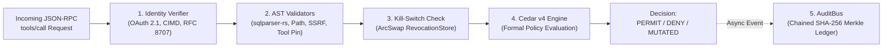

# Axiom NHI — Runtime Security Architecture & Inline Defense Specification

**Document:** `docs/architecture/complete-audit/RUNTIME_SECURITY.md`  
**Classification:** Zero-Trust Inline Policy Gate, Formal Verification & AST Defense  
**Primary Crates:** `services/extmcp/*`, `validators`, `identity`, `observability/*`  

---

## 1. Runtime Defense Architecture

Axiom NHI's core security mechanism is an **inline, fail-closed policy enforcement and threat-filtering pipeline** that executes on every JSON-RPC MCP tool invocation. It enforces zero-trust principles at wire speed (<2ms latency budget).

### 1.1 The Inline Evaluation Pipeline (`CheckPipeline`)

---

## 2. Core Security Verification Engines

### 2.1 Formal Authorization via AWS Cedar v4 (`extmcp_cedar`)
- **Technology:** Official `cedar_policy` v4 Rust crate.
- **Formal Verification:** Policies are written in Cedar's declarative language. Cedar guarantees formal mathematical soundness (decidability and type safety).
- **Strict Schema Enforcement:** All policies are schema-validated at load time (`ValidationMode::Strict`). Policies referencing undeclared entity types or context attributes fail closed during startup.
- **Lock-Free Hot Reload:** Cedar policies are encapsulated in `PolicySnapshot` behind an `arc_swap::ArcSwap`. Reading active policies during query evaluation requires zero mutex locks (`store.load()`). Installing a new bundle atomically swaps the pointer (`store.swap()`).

### 2.2 SQL AST Dialect Analysis (`validators::sql`)
- **Technology:** `sqlparser-rs` with multi-dialect support (PostgreSQL, MySQL, SQLite, Generic).
- **DDL Rejection:** Autonomous agents must never run destructive schema migrations. The parser inspects the AST for `Statement::Drop`, `Statement::Truncate`, `Statement::AlterTable`, or `Statement::Create*` and immediately yields a `DENY`.
- **Stacked Statement Trap:** Rejects query strings containing multiple statements (e.g. `SELECT 1; DROP TABLE users`).
- **Table Confinement:** Validates that all accessed tables exist within the agent's authorized Cedar context allowlist.

### 2.3 Filesystem Sandbox & Path Canonicalization (`validators::filesystem`)
- **Root Confinement:** All path arguments are canonicalized against the configured server root directory.
- **Traversal Traps:** Traps any input containing `../`, `..\`, `%2e%2e`, null bytes, or absolute roots.
- **Token Mount Protection:** Explicitly denies access to known credential mount points:
  - `/var/run/secrets/kubernetes.io`
  - `/etc/passwd`, `/etc/shadow`
  - `~/.aws/credentials`, `~/.ssh/id_rsa`

### 2.4 Egress Firewall & SSRF Defense (`validators::egress`)
- **DNS-Pinned Host Whitelisting:** Resolves target domains to IP addresses before allowing external HTTP calls.
- **Cloud IMDS Protection:** Traps and drops requests targeting AWS/GCP/Azure instance metadata services (`169.254.169.254`).
- **Private Subnet Traps:** Drops connections attempting to reach internal corporate ranges:
  - Loopback (`127.0.0.0/8`, `localhost`)
  - RFC 1918 private subnets (`10.0.0.0/8`, `172.16.0.0/12`, `192.168.0.0/16`)
  - IPv6 link-local and unique local addresses (`fe80::/10`, `fc00::/7`).

### 2.5 JCS RFC 8785 Tool Schema Pinning (`validators::tool_pin`)
- **The Problem:** Malicious MCP servers can silently update their tool schemas (a "tool rug-pull") to alter argument types, tricking the LLM into invoking dangerous side effects.
- **The Fix:** At registration, Axiom normalizes the tool schema using JSON Canonicalization Scheme (JCS RFC 8785) and computes its SHA-256 hash. If the live server schema hash diverges from the approved golden pin, all requests are quarantined (`MCP03:2025`).

---

## 3. Cryptographic Audit Ledger (`observability/audit`)

To ensure non-repudiation and prevent audit log tampering:
1. Every decision emits an `AuditEvent` with:
   - `principal_uid`
   - `tool_name`
   - `decision` (`PERMIT` vs `DENY`)
   - `latency_us`
   - `policy_version`
   - `prev_hash` (SHA-256 hash of the previous record)
   - `entry_hash` (SHA-256 hash of `[prev_hash + canonical_event_json]`)
2. The audit bus runs on an off-path dedicated thread, guaranteeing that disk I/O flushes never stall the <2ms inline evaluation path.
3. If an attacker deletes or alters a historical audit line, the Merkle chain breaks immediately.

---

## 4. Reality Classification: Implemented vs. Simulated Features

To provide total engineering transparency, the following table distinguishes verified code implementations from demonstration features:

| Security Feature | Implementation Status | Evidence / File Path | Notes |
|---|---|---|---|
| **Cedar v4 Policy Evaluation** | **Functional Implementation** | `services/extmcp/cedar/src/engine.rs` | Fully compiled and verified with real Cedar engine |
| **SQL AST Parsing & DDL Trapping**| **Functional Implementation** | `validators/src/sql.rs` | Uses `sqlparser-rs` |
| **Sub-50ms Kill-Switch** | **Functional Implementation** | `observability/kill-switch/src/service.rs`| Backed by `ArcSwap` and disk snapshots |
| **Chained Merkle Audit Ledger** | **Functional Implementation** | `observability/audit/src/writer.rs` | Real SHA-256 hash chaining |
| **RFC 8707 Resource Indicators** | **Functional Implementation** | `identity/src/resource_indicators.rs` | Validates audience against canonical resources |
| **OpenBao Dynamic Secret Leases** | **Functional Implementation** | `secretless/src/openbao.rs` | Full REST integration with external OpenBao container |
| **Hardware Nitro Enclaves** | **Planned Architecture** | Marketing claims in `/trust` | Currently runs in standard Docker/K8s containers |
| **Automated SPIRE SVID Attestation**| **Functional Prototype** | `identity/src/cimd/mod.rs` | CIMD and SVID parsing exist; automated daemon integration is in progress |
| **Terminal Simulator Demos** | **Interactive Presentation** | `apps/web/app/components/TerminalSimulator.tsx`| Pre-recorded scenarios designed for client education |
